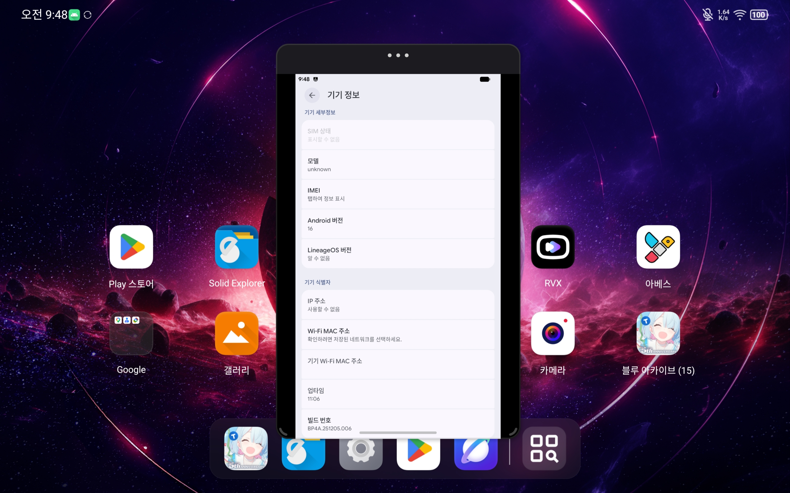

# SSAL: Stacked System Abstraction Layer
> The name came first. The acronym came later.



SSAL is a Rust-based native Android OS virtualization layer powered by KernelSU.

It runs a guest Android system, such as LineageOS **in Host OS**.

## Architecture
- Core runtime: Provide Guest Init, Binder, Property, SELinux, Mount, Lifecycle to Guest Android OS
- Concurrent Mode: Keeping Host Framework and run Guest OS seperately.
- Exclusive Mode: Stop Host Framework and run Guest OS exclusively. (not implemented)
 - switch & return command isn't implemented.

## Requirements
 * KernelSU ROOT (Jailbreak mode supported)
 * Android 15+
 * Backup your data before trying


## CLI Usage

* Set PATH for easy access
```sh
PATH=/data/adb/modules/ssal/bin:$PATH
```

* See all commands:
```sh
ssal --help
ssal <COMMAND> --help
ssal help <COMMAND>
```

### Environment Setup
Setup only once (after install ssal).

```sh
adb install ssal-surface.apk
ssal allow alyac.android.ssalsurface
```

### Prepare system image

```sh
ssal add lineage /sdcard/LineageOS-23.2-20260524-VANILLA-EXT4-GSI.img
ssal status
```

and see results like

```
HOST_ACTIVE
images:
lineage: 1795218001400-7681
profiles:
none
...
```


### Prepare profile
Create profile from system image (seperate userdata)

```sh
ssal create lineage profile1
# stdout: created profile profile1 for lineage (1795218001400-7681); userdata: 8589934592 bytes ext4 image; device compatibility unverified
```

Check profile

```sh
ssal doctor profile1
```

results:

```
profile: profile1
image: 1795218001400-7681
image SELinux context: u:object_r:ssal_image_file:s0 (expected)
image size and SHA-256: OK
system ext4 magic: OK
userdata raw ext4 image: /data/local/ssal/guests/profile1/userdata.img
space: 218475212800 bytes available
mount namespace: available
loop control: available
...
```

------

### Start Guest OS

Prepare environment before start

```sh
ssal prepare profile1
# mount cleanup and session loop backing release checks: OK
# prepare complete; worker exited; session-path host mounts checked absent
```

and Boot Guest OS

```sh
ssal start profile1
```

### Check Boot

* Check setup log

```sh
tail -n 100 /data/local/ssal/logs/guest-profile1.log
```

* Check logcat (with lots of errors)

```sh
ssal logcat
```

* Display

Wait until `Boot Completed` alert and open `SsalSurface` app.

You can watch and interact Guest OS's screen in app.

### Stop Guest OS (Unstable)

```sh
ssal stop profile1
```

May have Guest profile1 stop failed, then just hard reboot host os.

## Limitation
Only tested on `Lenovo Y702` with `ZYU 17.0.313`. No guaranteed to work for other devices.

**Current implementation is still very early so only basic android features are working.**

### Working
Basic android feauture

* Boot animation
* System Boot
* Launcher
* Calculator

### Not Working
**ELSE**

Network, Almost HAL, sound, navigation, settings, display brightness, etc

## Milestone
* 0.0.1: Initial boot success
* ... SoonTM

## Build

Use WSLc or Linux(manual rust/android ndk/jdk dependency required),

```
bun run build
```

## Reference

* [OneLineage](https://github.com/WeWaffles/OneLineage)
* [OneOS](https://github.com/fahadalijaved/OneOS)
* [RSBinder](https://github.com/hiking90/rsbinder)
* [RSProperties](https://github.com/hiking90/rsproperties)
* [KernelSU](https://github.com/tiann/kernelSU)

### AI Discorse

I've used codex(gpt)/antigravity(gemini) to implement project.

May have wrong implementation, have bad code quality, AI Slop docs.
