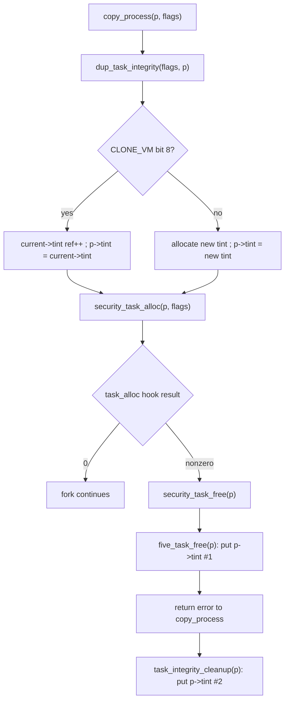

# BDZJ2 커널 바이너리의 Samsung FIVE double put 분석

조사일: 2026-11-06

최종 판정: **A. DOUBLE PUT PRESENT**

범위: `out/boot.img`와 BYI3 소스의 오프라인 정적 분석. 원본 이미지, 커널, SSAL, KernelSU, SELinux 정책은 수정하지 않았고 기기 조작·플래싱·패닉 재현은 하지 않았다.

## 요약

`out/boot.img`는 Android boot header v4 이미지다. 헤더가 지정한 커널 페이로드를 추출해 확인한 결과, 압축되지 않은 ARM64 커널이며 내장 release 문자열과 Samsung 후행 메타데이터가 패닉 기록의 S937N BDZJ2 식별자와 일치한다. 패닉 로그의 빌드 문자열 `6.6.127-android15-8-p87b1ce1-abogkiS937NKSSBDZJ2-4k`도 이미지에서 정확히 발견했다.

선택된 바이너리 구간은 `task_alloc` hook 오류가 난 경우 같은 자식 task의 FIVE 포인터에 두 번 put하는 것을 보여준다. `CLONE_VM` 분기에서는 부모와 공유하는 FIVE 객체의 참조를 하나 늘린 뒤 실패 정리에서 두 번 줄인다. 일반 fork 분기에서는 새 객체를 만든 뒤 첫 put으로 해제될 수 있고 caller의 두 번째 put은 해제된 객체를 다시 사용한다. 이 결함은 **실제 BDZJ2 이미지에 존재한다**.

다만 이전 패닉에서 이 fork 오류 분기가 실행됐거나 SELinux가 fork를 거부했다고 증명할 자료는 없다. 패닉은 RCU task-free 경로에서 발생했으며, 대상 task, clone flags, 직전 `task_alloc` 오류는 보존 로그에 없다. 따라서 정적 결함 판정과 당시 패닉의 원인 판정은 분리한다.

## 1. 이미지 식별 및 커널 추출

| 항목 | 확인값 |
|---|---|
| 입력 | `out/boot.img` |
| 크기 | 101,122,048 bytes |
| SHA-256 | `EA52237A309F187DB51233E275C71235839342DDFB395152BCB3D1BEC2E12213` |
| 이미지 magic / header | `ANDROID!`, boot header v4, header size 1,584 bytes |
| 커널 구간 | 이미지 오프셋 4,096, 크기 39,115,264 bytes, 끝 오프셋 39,119,360 |
| ramdisk / boot signature size | 각각 0 bytes |
| 추출 파일 | `out/five-bdzj2-analysis/kernel.raw` |
| 추출 커널 SHA-256 | `B7C039A47F7FCE72B6921E1E630E5309947D63EFDFFB91B70B4467061865A8BC` |

boot v3/v4의 4 KiB 첫 페이지 배치를 적용해 `[4096, 4096 + kernel_size)`를 별도 파일로 복사하고, 추출 길이와 LLVM의 파일 형식 판독을 확인했다. AOSP `unpack_bootimg.py`는 조사 대상 트리에서 찾지 못해 헤더 필드 기반으로 추출했다. 원본은 읽기만 했으며 분석 후 SHA-256이 처음 값과 동일했다.

`llvm-readobj --file-headers --sections` 결과는 추출물이 **COFF-ARM64** PE 이미지임을 보여준다. `.text`는 VMA/raw offset `0x10000`, `.data`는 `0x22d0000`이며 각 섹션의 raw offset과 VMA가 같아 아래 주소는 추출 이미지 기준 VMA로 직접 대응한다. AArch64 Image magic `ARMd`는 payload offset `0x38`에 있다. gzip/LZ4 등 압축 헤더는 없으며 추가 압축 해제는 하지 않았다.

내장 kernel release는 다음과 같다.

```text
Linux version 6.6.127-android15-8-p87b1ce1-abogkiS937NKSSBDZJ2-4k (kleaf@build-host) (Android (11368308, +pgo, +bolt, +lto, +mlgo, based on r510928) clang version 18.0.0 (https://android.googlesource.com/toolchain/llvm-project 477610d4d0d988e69dbc3fae4fe86bff3f07f2b5), LLD 18.0.0) #1 SMP PREEMPT Wed Oct 7 08:16:25 UTC 2026
```

이는 요청한 release 및 패닉 로그의 release와 정확히 같다. 후행 Samsung 메타데이터는 이미지 오프셋 `39,120,896`의 `SEANDROIDENFORCE`로 시작하고 `SignerVer02`, `S937NKSSBDZJ2`, `20261007180820`, `SM-S937N_KOR_KX_QKEY18`를 포함한다. 커널 뒤 나머지는 대부분 0 패딩이다. 패닉 로그의 별도 빌드 hash `4ada8571dcf2ef127627ffc0429891950f882248`는 추출 커널에서 찾지 못했다. 따라서 release·제품·펌웨어 식별은 일치하지만 해당 hash까지 이미지 자체로 대조한 것은 아니다.

## 2. 심볼 및 함수 위치 복구

커널 PE/COFF 헤더는 `PointerToSymbolTable=0`, `SymbolCount=0`, `IMAGE_FILE_DEBUG_STRIPPED`를 보고한다. 조사 대상에 대응하는 `vmlinux`, `System.map`, ELF 심볼 파일은 없었고 `vmlinux-to-elf`와 Ghidra 실행 파일도 PATH에서 찾지 못했다. 전체 kallsyms 주소표나 ELF는 복구하지 않았다. 문자열에 함수명이 보이는 것만으로 주소를 정하지 않았으며, 아래 선택 함수는 패닉의 함수 상대 오프셋, 고유한 기계어 시퀀스, 직접 call target과 데이터 흐름으로 대응했다.

| 코드 | 이미지 기준 위치 | 경계/근거 |
|---|---:|---|
| `five_task_free` | `0x725b90` | 패닉 심볼 크기 `0x70`; `PC+0x40`은 `0x725bd0` |
| `security_task_free` | `0x6f75ac` | 패닉 LR의 함수 크기 `0x7c`; `five_task_free` 호출은 `+0x58`, return PC는 `+0x5c` |
| `security_task_alloc` | `0x6f74ec` | caller의 직접 BL target과 task blob/hook 처리 흐름으로 식별; 별도 kallsyms 크기는 미복구 |
| `dup_task_integrity` | `0xac878` | copy-process callsite의 직접 BL target 및 clone-flag/data-flow로 식별 |
| `task_integrity_cleanup` | `0xac904` | 오류 분기의 직접 BL target 및 FIVE 포인터 put으로 식별; 원래 inline helper의 코드 위치 |
| `copy_process` | callsite `0xabbcc` | 직전 `dup_task_integrity`, 직후 오류 cleanup을 포함한 소스 대응으로 식별; 함수 전체 심볼 경계는 미복구 |
| `task_integrity_put` | 독립 위치 없음 | `five_task_free` 및 cleanup 코드에 inline된 것으로 확인 |
| `selinux_task_alloc` | 주소 미복구 | 문자열/소스 등록과 공통 hook dispatcher는 확인했지만 개별 함수 경계는 복구하지 못함 |

이 주소는 KASLR 적용 전 추출 이미지의 image-relative VMA이며 기기의 절대 실행 주소가 아니다. 다만 함수 상대 오프셋과 direct BL의 상대 주소 계산에는 절대 KASLR 주소가 필요하지 않다.

## 3. 기존 panic PC 검증

보존 로그의 원본 행 `18208–18209`, `18221–18229`에는 다음이 기록돼 있다 (`docs/boot-incident-20261106/panic-excerpt.txt`에도 같은 행이 발췌돼 있다).

```text
pc : five_task_free+0x40/0x70
lr : security_task_free+0x5c/0x7c
Code: 97fffd9d a8c17bfd d50323bf d65f03c0 (d4210000)
```

해당 5개 명령어 byte sequence는 추출 `.text`에서 한 번만 발견됐다. 이미지 기준 `0x725bc0`부터 로그의 네 선행 명령어가 그대로 있고, `d4210000`은 `0x725bd0`에 있다. 이는 `five_task_free` 추정 시작 `0x725b90`의 정확히 `+0x40`이다.

```asm
0x725b90  ldr     x0, [x0, #0xdd0]   // task의 FIVE 포인터
0x725b94  ldr     w8, [x0, #0x8]     // usage_count
0x725b98  cbz     w8, 0x725bd0
             ... atomic decrement; count가 0이 되면 0x725234 호출
0x725bd0  brk     #0x800             // d4210000, panic PC
```

따라서 PC는 `BUG_ON(!atomic_read(&intg->usage_count))`에 대응한다. source 위치는 `common/include/linux/task_integrity.h:148–153`이며 `usage_count`는 `struct task_integrity`의 offset `+8`이다. `common/security/samsung/five/five_main.c:452–454`의 `five_task_free()`는 이 put을 호출한다. 이 경로에서 `task_integrity_put()`은 별도 함수가 아니라 inline이다.

이 기계어는 BYI3의 엄격한 `BUG_ON` 구현과 일치한다. 같은 트리의 별도 `security/samsung/five/gki/task_integrity.h`가 가진 zero/null 조기 반환 코드를 이 panic 경로에 적용할 수 없다. 실제 실행 이미지의 PC와 명령어가 엄격한 구현을 직접 식별한다.

## 4. 실제 BDZJ2 double put 제어·데이터 흐름

### 바이너리 근거

1. `dup_task_integrity`는 `0xac878`에서 시작한다. `0xac88c: tbnz w0, #8`은 `CLONE_VM` (`0x100`, bit 8) 분기다.
   - bit가 꺼진 일반 fork 경로는 `task_integrity_alloc()`에 해당하는 `0x7251f0`을 호출한 뒤 새 포인터를 child task의 `[p + 0xdd0]`에 저장한다. 실패하면 `-ENOMEM`을 반환한다.
   - bit가 켜진 `CLONE_VM` 경로는 current task의 `[current + 0xdd0]`에서 기존 포인터를 읽고 `usage_count`를 증가시킨 뒤 같은 포인터를 `[p + 0xdd0]`에 저장한다.
2. callsite `0xabbb8`은 `x0=clone_flags`, `x1=p`로 `0xac878`을 호출한다. 성공 후 `0xabbcc`는 `x0=p`, `x1=clone_flags`로 `security_task_alloc()` (`0x6f74ec`)을 호출한다.
3. `security_task_alloc()`의 hook list loop는 task와 clone flags를 hook에 전달한다. hook이 0을 반환하면 다음 hook으로 진행하고, nonzero면 오류 코드를 보존한 채 `0x6f7584`에서 `security_task_free(p)` (`0x6f75ac`)를 호출한 뒤 같은 오류를 반환한다.
4. panic의 LR와 맞는 `security_task_free+0x58`의 BL은 `five_task_free` (`0x725b90`)로 간다. 이후 `[p + 0xba8]`의 LSM security blob만 해제·NULL 처리한다. FIVE 포인터 `[p + 0xdd0]`은 지우지 않는다.
5. `copy_process`에서 `security_task_alloc()` 반환값이 nonzero면 `0xabbd0`의 분기가 오류 경로로 가고, `0xabbdc`에서 **같은 `p` 레지스터**를 `task_integrity_cleanup()` (`0xac904`)에 전달한다. 이 cleanup도 `[p + 0xdd0]`을 읽고 `usage_count`를 검사한 뒤 put한다. 이 경로는 `bad_fork_cleanup_audit`로 이동해 일반 `bad_fork_cleanup_security`의 추가 `security_task_free()`를 통과하지 않는다.

핵심 명령어 요약:

```asm
0xabbb8  bl    0xac878              // dup_task_integrity(flags, p)
0xabbcc  bl    0x6f74ec             // security_task_alloc(p, flags)
0xabbd0  cbz   w0, success
0xabbd8  mov   x0, x19               // 동일한 child p
0xabbdc  bl    0xac904              // task_integrity_cleanup(p), put #2

0x6f7574  blr   x8                  // task_alloc LSM hook
0x6f7578  cbz   w0, next_hook        // nonzero이면 아래 cleanup
0x6f7580  mov   x0, x19              // 동일한 task p
0x6f7584  bl    0x6f75ac             // security_task_free(p)

0x6f7600  mov   x0, x19
0x6f7604  bl    0x725b90             // five_task_free(p), put #1
0x6f7608  ldr   x0, [x19, #0xba8]    // LSM blob 해제
0x6f7610  str   xzr, [x19, #0xba8]   // security만 NULL 처리

0xac904   ldr   x0, [x0, #0xdd0]     // task_integrity_cleanup의 같은 필드
0xac908   ldr   w8, [x0, #0x8]
0xac90c   cbz   w8, 0xac944
0xac944   brk   #0x800
```



같은 `p + 0xdd0` 필드가 양쪽에서 읽히고, 중간에 `security_task_free()`는 이 필드를 변경하지 않는다. NULL/state 플래그 검사도 두 번째 put 앞에 없다. 따라서 두 put이 같은 객체 참조에 도달할 수 있음이 바이너리 제어 흐름과 데이터 흐름으로 확인된다.

BYI3 `include/linux/task_integrity.h:116–133`의 `TASK_INTEGRITY` 매크로는 설정에 따라 `android_oem_data1[2]` 또는 `task->integrity`를 가리킨다. 바이너리에서는 이 포인터 필드 접근이 `[task + 0xdd0]`로 보인다.

### 참조 수 변화

| 분기 | `dup_task_integrity` | hook 오류 정리 |
|---|---|---|
| 일반 fork (`!CLONE_VM`) | 새 객체 할당, `usage_count=1`, child에 저장 | `security_task_free`가 첫 put으로 객체를 해제할 수 있다. caller cleanup은 같은 포인터를 다시 사용하므로 double put/UAF다. 재사용된 메모리 상태에 따라 다음 관측은 달라질 수 있다. |
| `CLONE_VM` | 부모의 기존 객체를 child에 공유하고 참조 수를 1 증가 | 내부 put과 caller put이 공유 참조 수를 두 번 줄인다. 부모만 기존 소유자였으면 두 번째 put에서 객체가 해제되어 부모 포인터가 stale 상태가 된다. 이후 task-free에서 0-count BUG가 가능하다. |

`task_integrity_alloc()`이 새 객체의 count를 1로 설정하는 것은 `common/security/samsung/five/task_integrity.c:51–60`에서 확인된다. 실제 양쪽 경로의 refcount 연산은 위 바이너리 disassembly에도 있다.

`lsm_task_alloc()`의 blob 할당 자체가 실패하는 경로는 `security_task_alloc()`에서 바로 오류 반환하며 내부 `security_task_free()`로 가지 않는다. 그 경우 caller의 `task_integrity_cleanup()` 한 번뿐이다. 확인된 double put 조건은 blob 준비 이후 `task_alloc` hook이 nonzero 오류를 반환해 내부 free까지 실행되는 경로다. 바이너리에는 별도 helper call도 관측되지만 해당 helper의 함수명은 복구하지 못했다. 이 helper의 오류 경로 역시 같은 내부 cleanup으로 합류한다.

## 5. SELinux fork 거부 조건

BYI3 `common/security/selinux/hooks.c:3996–4002`의 `selinux_task_alloc()`은 `avc_has_perm(sid, sid, SECCLASS_PROCESS, PROCESS__FORK, NULL)` 결과를 반환하고, `:7104`에서 `task_alloc` hook으로 등록된다. 따라서 해당 hook이 포함되고 Enforcing 정책에서 권한 검사가 거부되면 nonzero 반환이 가능하다. BDZJ2 바이너리에서는 generic `task_alloc` hook loop의 nonzero 반환이 `security_task_free()`로 이어지는 것을 확인했다.

개별 `selinux_task_alloc`의 주소와 함수 본문은 stripped 이미지에서 독립적으로 복구하지 못했으므로, 위 SELinux 권한 조건은 BYI3 소스 근거다. 보존 `last_kmsg.txt`를 `avc: denied`, `PROCESS__FORK`, `selinux_task_alloc` 패턴으로 사전 필터했지만 일치 항목은 없었다. 이 정적 경로만으로 당시 SELinux 거부를 단정할 수 없다.

## 6. BYI3 소스 및 common/msm-kernel 대조

| 항목 | BDZJ2 바이너리 | BYI3 common 소스 | 상태 |
|---|---|---|---|
| `five_task_free` / `task_integrity_put` | panic PC와 일치하는 zero-check → `brk #0x800`; decrement-to-zero 시 free | `five_main.c:452–454`, `include/linux/task_integrity.h:148–153` | **MATCH** |
| `security_task_free` | panic LR의 `+0x5c/0x7c`가 `five_task_free` 호출 직후와 일치; LSM blob만 NULL 처리 | `security.c:2930–2936` | **MATCH** |
| `security_task_alloc` | hook list의 nonzero 결과가 `security_task_free`로 이동 | `security.c:2911–2920` | **MATCH**; 추가 helper 한 개는 미식별 |
| `dup_task_integrity` | `CLONE_VM` 분기에서 ref++/공유, 일반 fork에서 alloc/대입 | `kernel/fork.c:2010–2025` | **MATCH** |
| `task_integrity_cleanup` | 오류 경로에서 같은 task 포인터의 FIVE 필드를 다시 put | `kernel/fork.c:2028–2031` | **MATCH** |
| `copy_process` 오류 분기 | dup → security alloc → 오류 시 cleanup 순서 확인 | `kernel/fork.c:2579–2585` | **MATCH** |
| `selinux_task_alloc` | 공통 hook dispatch는 확인; 개별 함수 위치/본문 미복구 | `selinux/hooks.c:3996–4002, 7104` | **INCONCLUSIVE** (소스에서는 거부 가능) |

체크아웃된 `msm-kernel/kernel/fork.c:2523`에는 `security_task_alloc()` 호출은 있지만 `dup_task_integrity()`와 해당 실패 cleanup이 없다. 반면 실제 이미지의 `0xac878` helper와 `0xabbb8–0xabbdc` 호출 순서는 `common/kernel/fork.c`의 구현을 재현한다. 따라서 이 결론은 msm-kernel 복사본만 보고 추정한 것이 아니라 BDZJ2 바이너리의 동작을 우선한 결과다. 바이너리만으로 빌드 시스템이 어느 경로의 소스 파일을 선택했는지는 판정하지 않는다.

## 7. 패닉과 double put의 관계 및 한계

기존 로그의 call trace는 `five_task_free → __put_task_struct → delayed_put_task_struct → rcu_do_batch → rcu_nocb_cb_kthread`이며 실행 task는 RCU worker `rcuop/4`다 (`last_kmsg.txt:18205–18229`). 이는 0-count `five_task_free`와 양립하지만, 문제를 일으킨 자식 task나 앞선 fork 실패를 보여주지 않는다. 기록에는 해당 task의 clone flags, `security_task_alloc()` 반환값, SELinux AVC 거부가 없다.

따라서 결론은 다음과 같다.

- **정적 BDZJ2 결함: 확인됨 — DOUBLE PUT PRESENT.** 같은 task-integrity 객체에 도달하는 두 put 경로가 실제 이미지에서 확인됐다.
- **이번 panic의 직접 원인: 미확정.** 관측된 RCU free panic이 이 결함의 후속 결과일 수 있지만, 이 로그만으로 해당 오류 경로가 실행됐음을 증명할 수 없다.
- **정확한 빌드 hash: 미대조.** release 문자열, S937N 제품 표식, BDZJ2 후행 메타데이터는 일치하지만 panic의 `4ada8571...` hash는 이미지에서 찾지 못했다.
- **분석 경계:** 전체 kallsyms/vmlinux 복구와 `selinux_task_alloc` 개별 함수 역어셈블은 완료하지 못했다. 선택된 핵심 경로는 패닉 상대 오프셋, 고유 instruction bytes, 직접 call target 및 동일 task 필드 접근으로 판정했다.

다음 조사에서는 같은 BDZJ2 빌드의 `vmlinux`/`System.map`/`.config`를 확보하면 남은 함수 경계, SELinux hook 구현, 빌드 hash를 대조할 수 있다. 패닉 원인을 좁히려면 재현하지 말고 보존 로그에서 `PROCESS__FORK` AVC/audit, `security_task_alloc()` 오류 코드, 대상 PID와 clone flags를 함께 확보해야 한다.

## 8. 근거 파일 및 확인 명령

- 입력: `out/boot.img` (원본 보존)
- 추출: `out/five-bdzj2-analysis/kernel.raw`
- 패닉 발췌: `docs/boot-incident-20261106/panic-excerpt.txt`; 원본 행 번호는 발췌에 보존됨
- 소스: `vendor/S937NKSU2BYI3/kernel_platform/common/` 및 해당 `msm-kernel`의 `fork.c`

주요 재확인 명령:

```text
llvm-readobj --file-headers --sections out/five-bdzj2-analysis/kernel.raw
llvm-objdump -d --start-address=0x725b90 --stop-address=0x725c00 out/five-bdzj2-analysis/kernel.raw
llvm-objdump -d --start-address=0x6f74ec --stop-address=0x6f7628 out/five-bdzj2-analysis/kernel.raw
llvm-objdump -d --start-address=0xac878 --stop-address=0xac970 out/five-bdzj2-analysis/kernel.raw
llvm-objdump -d --start-address=0xabb00 --stop-address=0xabca0 out/five-bdzj2-analysis/kernel.raw
```

panic 명령어 byte sequence의 이미지 내 유일성 및 direct BL call target도 추출된 로컬 바이너리에서 검색했다. 실기기 접근, 네트워크 분석, 커널 변경은 수행하지 않았다.
