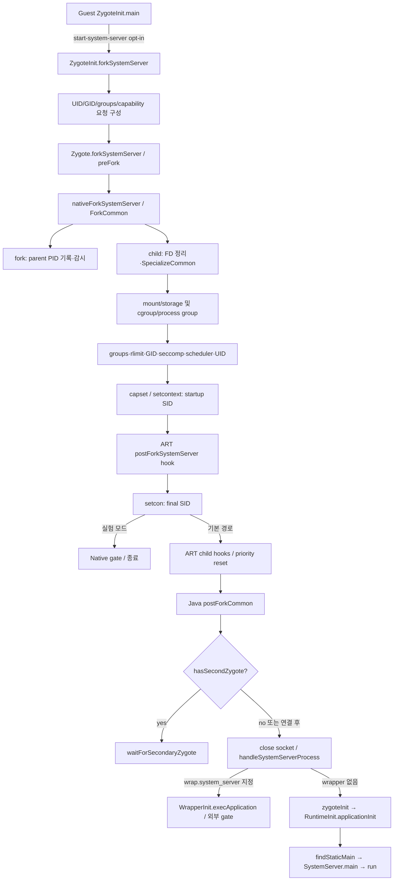

# Phase 8B-4A — Guest `SystemServer` Native Specialization 사전 분석

- 조사일: 2026-11-06 KST
- 범위: GSI의 Guest Zygote `forkSystemServer()` 경로, native specialization 순서, Host 경계, Phase 8B-4B 안전 검증 계획
- 실행 제한: 정적 분석만 수행. Guest system-server fork, `SystemServer.main()`/`run()`, SELinux 정책 변경·allow, permissive 전환, KernelSU `selinux_hide` 변경은 하지 않았다. Host SELinux Enforcing 유지.

## 판정 요약

**무가드 Framework 실행은 금지한다.** B4B는 Host `system_server_startup`과 `system_server` SID 재사용을 별도의 위험 평가 대상으로 유지한다. Guest 전용 SID는 필수 선행 조건이 아니며 신규 SELinux 정책 구현은 이번 단계의 기본 목표가 아니다. SID 및 PID/user namespace 공유는 격리가 아니지만 그 자체가 실험의 자동 실행 불가 사유는 아니다. 실제 간섭 경로와 통제 조건을 아래에서 검토한다.

8B-3D 수정은 App 동일 SID 검증에 한정된다. system-server 최종 SID 치환은 구현되지 않았고 이 실험의 선행 조건도 아니다. 8B-3B의 별도 native helper에서 stock 전이가 성공했지만 실제 Zygote fork 결과는 아직 모른다. 아래는 설계이며 실기기 PASS를 뜻하지 않는다.
## 대상과 근거 수준

분석 대상 이미지는 Phase 8B-2/8A에서 고정한 `out/LineageOS-23.2-20260524-VANILLA-EXT4-GSI.img` (SHA-256 `7b9ba62e8b48b6e40432be949ae0858a8971175c79502550e74691222d3889ff`, Android 16 / SDK 36, Build ID `BP4A.251205.006`)다. 추출된 `framework.jar`, `libandroid_runtime.so`, `libselinux.so` SHA-256은 각각 `cc72f9cd2d55bf8b1f0afa50cb3c8a06baadac0bade9b7995cf41aa9dfb95590`, `d35220026ef94be6992d8b9b31cd446f937b8e782833813b2ac68140f41fc035`, `9801ecf09ba52fcdd937b8195119996450628cf66e40b5896c1c5475411d3818`이다. 기준은 [8B-2 전환 분석](phase8b2-selinux-transition.md)이다.

Java 경로는 추출 GSI `framework.jar`에서 복원한 [`ZygoteInit.java`](../out/phase7fb/source/ZygoteInit.java), [`Zygote.java`](../out/phase7fb/source/Zygote.java), [`RuntimeInit.java`](../out/phase7fb/source/RuntimeInit.java)로 대조했다. Native 순서는 GSI와 일치하는지 독립 재현하지 않은 Android 16 AOSP 소스 스냅샷 [`com_android_internal_os_Zygote.cpp`](../out/phase7fb/source/com_android_internal_os_Zygote.cpp)과 이미지의 ELF 분석을 함께 사용했다. ELF에서 `setcontext`/`setcon` import와 호출 위치를 확인한 기존 [interposition 분석](zygote-setcon-interposition-20261106.md)을 보조 근거로 삼았다. LineageOS의 정확한 source manifest/commit은 확보되지 않았으므로 **C++ 소스 순서의 GSI 바이너리 일치는 추정**으로 남긴다. 실기기에서 해당 fork 경로 자체는 실행하지 않았다.

## 호출 경로

현재 SSAL은 Guest Zygote만 시작하고 `--start-system-server`를 전달하지 않는다([`guest_launcher.rs`](../src/guest_launcher.rs#L1240)). 아래 fork는 Phase 8B-4B에서 별도 1회성 gate를 넣을 때만 대상이다.

정적 호출 관계:

1. `ZygoteInit.forkSystemServer()`가 system_server용 인자와 capability 요청을 만들고 `Zygote.forkSystemServer()`를 호출한다([GSI 복원 코드](../out/phase7fb/source/ZygoteInit.java#L691)).
2. `Zygote.forkSystemServer()`가 `preFork()` 후 JNI `nativeForkSystemServer()`를 호출한다. Child에서는 JNI specialization이 끝난 뒤 Java `postForkCommon()`을 수행한다([GSI 복원 코드](../out/phase7fb/source/Zygote.java#L503)).
3. JNI는 `ForkCommon()`에서 fork한다. Parent는 child PID를 저장하고 조기 사망을 `waitpid(WNOHANG)`로 확인한다. Native child는 `SpecializeCommon()`을 마치고 JNI로 돌아온다([GSI native source snapshot](../out/phase7fb/source/com_android_internal_os_Zygote.cpp#L2639)).
4. Child는 `hasSecondZygote()`가 참이면 `waitForSecondaryZygote()`에 먼저 들어간다. 이후 Zygote socket을 닫고 `handleSystemServerProcess()`를 호출한다([GSI 복원 코드](../out/phase7fb/source/ZygoteInit.java#L777)).
5. `handleSystemServerProcess()`에서 `mInvokeWith`가 있으면 `WrapperInit.execApplication()` 경로로 나가며 `zygoteInit()`을 호출하지 않는다. 그 외에는 `zygoteInit()` → `RuntimeInit.applicationInit()` → `findStaticMain()`이 `com.android.server.SystemServer`를 로드하고 `main(String[])`을 찾아 `Runnable`을 반환한다. `ZygoteInit.main()`의 child가 그 Runnable을 실행해 `SystemServer.main()`에 도달한다([`handleSystemServerProcess`](../out/phase7fb/source/ZygoteInit.java#L485), [`RuntimeInit.findStaticMain`](../out/phase7fb/source/RuntimeInit.java#L330), [AOSP Android 16 `SystemServer.java`](https://android.googlesource.com/platform/frameworks/base/+/android16-qpr2-release/services/java/com/android/server/SystemServer.java)).

`SystemServer.main()`보다 먼저 native path에서 ART system-server post-fork hook과 system-server classloader prefetch가 실행될 수 있다. 이는 `SystemServer.main()`/`run()`이나 framework service bootstrap과 다른 단계다. 안전 gate는 `zygoteInit()` 및 `applicationInit()`보다 앞에 있어야 한다. `findStaticMain()`은 `Class.forName(..., true, ...)`로 대상 class를 초기화하므로 이 호출 뒤에 멈추는 설계는 늦다.

## Native specialization 실제 순서

GSI Java 인자는 UID/GID `1000/1000`, supplementary groups `1001,1002,1003,1004,1005,1006,1007,1008,1009,1010,1018,1021,1023,1024,1032,1065,3001,3002,3003,3005,3006,3007,3009,3010,3011,3012`, nice name `system_server`, class `com.android.server.SystemServer`를 요청한다. Capability 후보는 `CAP_IPC_LOCK`, `CAP_KILL`, `CAP_NET_ADMIN`, `CAP_NET_BIND_SERVICE`, `CAP_NET_BROADCAST`, `CAP_NET_RAW`, `CAP_SYS_NICE`, `CAP_SYS_PTRACE`, `CAP_SYS_TIME`, `CAP_SYS_TTY_CONFIG`, `CAP_WAKE_ALARM`, `CAP_BLOCK_SUSPEND`다. Java는 이 mask를 **Guest Zygote의 현재 `CapEff`와 교집합**한다([GSI `ZygoteInit.java`](../out/phase7fb/source/ZygoteInit.java#L691)). 이 요청값을 child의 실효 capability로 간주하면 안 된다.

| 순서 | native 작업 | 결과·의존성 |
|---|---|---|
| 1 | `ForkCommon()`이 SIGCHLD 처리, zygote FD allowlist/restat, `fork()` 및 child FD 정리를 한다. system-server fork는 priority-fork 경로다. | 초기 child는 높은 scheduler priority를 받을 수 있다. `SpecializeCommon()` 끝에서 기본 priority로 낮춘다. gate를 오래 대기시키지 말고 CPU/memory 한도를 둔다. |
| 2 | `nativeForkSystemServer()`가 `SpecializeCommon()`에 `is_system_server=true`, `rlimits=null`, `bounding_capabilities=0`, `MOUNT_EXTERNAL_DEFAULT`, `seInfo=null`, `niceName=null`, `mount_data_dirs=false`, `mount_storage_dirs=false`를 준다. | system-server 요청에 app data 디렉터리 isolation은 없지만, storage mount 경로는 별도로 실행된다. |
| 3 | `MountEmulatedStorage()`가 `MOUNT_EXTERNAL_DEFAULT`를 처리하며 Guest child에서 `CLONE_NEWNS` mount namespace를 만들고 `/mnt/user/0`을 `/storage`에 bind한다. 뒤의 `ensureInAppMountNamespace()`는 이미 생성된 namespace면 재사용한다. | 이 시점에는 Guest Zygote가 root여야 한다. Mount propagation이 private인지, `/mnt/user/0` 및 `/storage`가 Guest root 안에 있는지, bind가 Host mount에 전파되지 않는지 확인한다. Namespace 분리는 `/proc` PID 분리가 아니다. |
| 4 | `getuid()==0`이면 `createProcessGroup(1000, child_pid)`를 실행한다. `UsePerAppMemcg()`가 참이면 `SystemMemoryProcess` task profile도 적용한다. | `createProcessGroup()` 실패는 fatal이다. `SystemMemoryProcess` profile 실패는 로그 후 진행한다. GSI 설정에는 v1 `/dev/cpuctl`, `/dev/cpuset`, `/dev/blkio`와 v2 `/sys/fs/cgroup` memory/freezer가 있다. SSAL은 `ssal_guest` 하위 트리만 bind한다([Guest cgroup mount](../src/guest_mounts.rs#L733)). |
| 5 | `setgroups()`로 supplementary groups를 적용하고 `SetRLimits(null)`은 no-op이다. 그 뒤 system-server classloader/standalone jar prefetch callback이 실행될 수 있다. | GSI에는 명시적 system-server rlimit 요청이 없다. child limits는 Zygote 상속값으로 시작하므로 gate에서 `/proc/<pid>/limits`를 기록한다. Prefetch는 framework service 시작이 아니지만 Java/ART 작업이다. |
| 6 | `setresgid(1000,1000,1000)` → system seccomp 설치 → scheduler 정책 적용 → `setresuid(1000,1000,1000)` 순서다. | `setgroups`, GID, seccomp, scheduler, UID 순서를 보존한다. 이 단계 전후의 syscall 실패는 Zygote `fail_fn`으로 child를 종료한다. |
| 7 | `SetCapabilities()`가 전달된 permitted/effective mask를 적용한다. system-server call의 bounding mask는 0이며 native code는 요청 외 bounding capabilities를 drop한다. | 예상 child `CapEff/CapPrm/CapBnd`, `Seccomp`, `NoNewPrivs`를 실제 `/proc/<pid>/status`에서 읽는다. `CAP_KILL`, `CAP_SYS_PTRACE`, `CAP_SYS_TIME`, `CAP_SYS_TTY_CONFIG`, `CAP_SYS_NICE`, `CAP_WAKE_ALARM`, `CAP_BLOCK_SUSPEND`의 Host 영향 여부는 namespace 이름만으로 격리됐다고 볼 수 없다. |
| 8 | `selinux_android_setcontext(1000, true, null, null)`이 seapp 규칙에서 startup context를 계산·검증·설정한다. 이후 thread name 및 SIGCHLD 처리 정리, ART `postForkSystemServer` hook, 고정 label `u:r:system_server:s0`로 `selinux_android_setcon()` 호출이 이어진다. 마지막에 ART child hook과 priority reset이 있다. | 실패는 fatal이며 final setter 이전에 중단될 수 있다. Host와 같은 final type은 Guest isolation이 아니다. `setcontext`/`setcon` 성공 후 Guest property area 재초기화 결과도 확인해야 한다. |

**중요한 cgroup 관측 한계:** Phase 7F-B fork 시험에서는 Guest `/sys/fs/cgroup/apps` 누락 때문에 이 경로에 준비가 필요했고, memory controller activation 경고가 남았다. 그 시험에서도 최종 자식의 정상 process-group specialization은 미확인이다([Phase 7F-B 결과](zygote-phase7fb-fork-results.md#cleanup-host-보존-및-readiness-회귀)). 따라서 기존 Guest cgroup mount가 있다는 사실만으로 `createProcessGroup(1000,pid)`나 `SystemMemoryProcess` 성공을 추정하지 않는다.

## UID/GID, SELinux, namespace와 Host 경계

### UID/GID 및 capability

- system_server는 Host One UI `system_server`와 같은 UID/GID 1000을 요청한다. supplementary groups도 위 GSI 목록 그대로 요청된다.
- GSI가 요청하는 capability는 Guest Zygote의 effective mask로 제한되지만, 실제 Guest Zygote와 child의 `CapEff`, `CapPrm`, `CapBnd`, inheritable/ambient 값은 아직 모른다.
- 공유 PID/user namespace에서는 UID 1000이 Host `system_server`와 겹친다. `CAP_KILL`이 없어도 동일 UID 대상 신호는 DAC상 가능할 수 있고, `CAP_KILL`은 대상 UID가 다른 Host process에 대한 위험을 더한다. `CAP_SYS_PTRACE` 및 공유 `/proc`도 별도 차단 증거가 없다.
- Guest net namespace는 `CAP_NET_ADMIN`/`CAP_NET_RAW`의 네트워크 범위를 줄이지만 `CAP_SYS_TIME`, TTY, PID, process signal/ptrace, wake/suspend 관련 권한까지 격리하지 않는다.

### Namespace 처리

| 영역 | 현재 동작 | Host 의존성 |
|---|---|---|
| mount | Guest Zygote는 이미 private Guest root 안에서 실행되고, child specialization은 별도 `CLONE_NEWNS`를 사용한다. | Guest `/storage`, `/data`, `/dev`, `/sys/fs/cgroup` 경로의 mount가 독립이고 propagation이 private인지 재확인한다. |
| network | SSAL Guest Zygote가 `CLONE_NEWNET`을 수행하고 child는 이를 상속한다([launcher](../src/guest_launcher.rs#L934)). | 추상 socket/network namespace는 분리된다. 다른 kernel-wide capability 경계까지 보호하지 않는다. |
| PID | `CLONE_NEWPID` 경로가 없다. Guest `/proc`은 새 mount여도 Host와 PID 번호 공간을 공유한다. | Host PID가 보이고 Host process 신호 대상이 될 수 있다. 현재 Phase 8A가 `/proc`를 `SHARED`, Host `/proc/<pid>/root`, FD, ptrace, signal을 `UNKNOWN`으로 분류했다([8A 경계표](system-server-phase8a-host-boundaries.md#자원별-분류)). |
| user | `CLONE_NEWUSER`/UID mapping이 없다. | UID 1000 및 capability user-namespace scope가 Host와 겹친다. |
| cgroup | 새 cgroup namespace는 만들지 않는다. Guest 경로에 session-owned `ssal_guest` 하위 트리를 bind한다. | cgroup은 namespace 격리가 아니라 같은 kernel의 자원 계층이다. membership/`cgroup.procs`가 Guest subtree 밖으로 이동하지 않는지 확인해야 한다. |

Private Binder, Guest socket/property area, Guest userdata는 재사용 가능한 경계다. Phase 7I는 Private Binder Java probe, Guest Property Service 및 별도 userdata를 검증했지만, `SystemServer`의 `ProcessState`, framework service 등록, full property-context 접근은 검증하지 않았다([7I 결과](guest-property-supervisor-integration.md)). Native SELinux transition이 property mapping을 재초기화한 뒤에도 Guest property area/socket identity가 Host와 다른지 B4B에서 재확인해야 한다.

현재 launcher는 Guest `derive_classpath`에서 나온 `SYSTEMSERVERCLASSPATH`와 선택적 `STANDALONE_SYSTEMSERVER_JARS`를 검증해 Guest Zygote 환경에 넣는다([launcher](../src/guest_launcher.rs#L1233), [8B-1 preflight](phase8b1-preflight-results.md)). Host 환경은 기존 `env_clear()`로 상속하지 않는다. 이로써 classpath **입력 경로**는 마련됐지만, native classloader prefetch나 framework class load의 실기기 성공을 증명하지 않는다. Private Binder/AIDL PASS는 실제 Android `servicemanager` 또는 framework Binder `ProcessState`의 동작으로 확대하지 않는다.

### Phase 8B-3B~3D와의 연결

- 8B-3B UID 1000 native diagnostic은 stock GSI 규칙에서 `ssal_guest_probe → system_server_startup → system_server` 두 context API가 성공하는 것을 확인했다. 이것은 **Host와 같은 type**으로 가는 별도 native helper 결과이며, 실제 `forkSystemServer()` 결과나 Guest system-server 격리 PASS가 아니다([8B-3B](phase8b3b-results.md)).
- 8B-3D는 UID 10000 app child에서 `selinux_hide` 정책 뷰가 Guest context 검사에 `EINVAL`을 반환하는 원인을 확인했다. 동일 SID shortcut은 target과 current SID가 같을 때만 적용된다. system-server의 startup/final target은 현재 Guest SID와 다르므로 그 shortcut이 transition 검증을 생략하지 않는다([8B-3D](phase8b3d-app-selinux-trace.md)). UID 1000 native probe에서는 stock startup context query가 통과했지만 새 Guest system-server type은 아직 검증하지 않았다.
- 8B-3B no-op interposer는 `setcontext()`를 건너뛰므로 system-server에 쓰면 안 된다. final `setcon()`만 호출되게 만들어 startup/final 단계 의미를 바꾸면 안 된다. App 전용 `SSAL_PHASE7FC_BYPASS_SETCONTEXT`, `SSAL_PHASE8B3B_NOOP`, trace-only 8B-3D flag도 B4B system-server 실행에서 끈다.
- 8B-2의 `ssal_guest_system_server_startup`/`ssal_guest_system_server`는 후보일 뿐 정책에 적용되지 않았다. 이번 stock SID 실험에는 이를 적용하지 않는다. Host 기존 domain allow 추가나 전역 permissive 없이 Host Enforcing을 유지한다.

## 공유 SID의 실제 Host 간섭 경로

같은 SID에는 Host `system_server`에 허용된 SELinux 권한이 적용된다. 다음은 가능한 경로이며 실제 접근 성공의 증거는 아니다. mount/network 분리는 상속 FD, 전역 커널 객체, 공유 PID/user 공간을 자동으로 차단하지 않는다.

| 경로 | 위험과 통제 |
|---|---|
| signal, ptrace, `/proc` | UID 1000 일치만으로 DAC 신호 조건이 성립할 수 있고 `CAP_KILL`, `CAP_SYS_PTRACE`와 공유 SID 정책이 추가 접근을 허용할 수 있다. `/proc/<pid>/root`, `fd`, `mem`은 각 접근 검사에 좌우된다. 무해한 Host canary만 대상으로 측정하고, 필수 차단 경계의 접근이 성공하면 fork하지 않는다. 핵심 Host 서비스에 신호나 ptrace를 보내지 않는다. |
| 상속 FD, Binder, property, socket | fork 이전에 열린 Host FD는 namespace 분리 후에도 남을 수 있다. Host endpoint에 연결하면 공유 SID 권한으로 영향을 줄 수 있다. Zygote FD와 실제 inode를 검사하고 명시된 Guest endpoint와 제어 FD만 허용한다. private Binder/property/data identity를 대조한다. |
| mount, cgroup, 파일 | 노출된 Host 파일이나 cgroup 제어 파일에 쓰기가 가능할 수 있다. storage bind와 `createProcessGroup`은 gate 이전에 실행된다. Guest mount propagation, writable 경로, 전용 subtree, membership과 유한 자원 한도를 사전 확인한다. |
| capability, 전역 상태 | network namespace는 `CAP_SYS_TIME`, `CAP_SYS_NICE`, wake/suspend 권한을 격리하지 않는다. 가능한 최소 capability로 Zygote를 시작하고 실제 mask를 확인한다. 필요한 권한 제거로 실패하면 실패를 기록하고 무제한 권한으로 자동 재시도하지 않는다. |
| gate 이전 코드 | native mount, cgroup 및 ART hook이 실행된다. Java wrapper 이전에도 작업이 있으므로 wrapper만을 안전장치로 삼지 않는다. |

Canary 거부만으로 모든 Host 객체의 접근 거부를 증명할 수 없다. 이 실험은 제한된 실행 경로, capability/FD/mount 통제 및 짧은 수명에 의존한다.

## 단발성 native 정지 설계

1. 기본 `start_system_server=false`를 유지하고 별도 명시적 실험 모드에서만 한 번 fork한다. Guest init rc를 실행하지 않고 Host Enforcing, KernelSU `selinux_hide`, 기존 Guest isolation과 stock startup/final SID를 유지한다. 8B-3B no-op과 app 전용 우회 flag는 끈다.
2. `wrap.system_server` 선택 여부와 무관한 독립 차단 장치로, 실제 GSI native 경로의 **final `selinux_android_setcon("u:r:system_server:s0")` 성공 직후, ART child hook과 JNI 반환 이전**에 child 전용 fail-closed gate를 설치하는 방안을 우선 검증한다. Gate는 성공 시에도 보고 후 종료하고 원래 코드로 복귀하지 않는다. setter 실패는 기존 fatal 경로를 유지한다. Wrapper는 보조 수단일 뿐 차단의 전제가 아니다. 실제 binary 제어 흐름, hook 적용 및 원래 setter 반환값을 확인해야 한다. 아직 구현되지 않았다. Hook 누락·오적용, 예상 외 호출 또는 검증 실패에도 Java로 돌아가지 않는 독립 강제 종료가 입증되지 않으면 fork하지 않는다. Host binary나 일반 app 호출은 변경하지 않는다.
3. Gate는 미리 열린 Guest 전용 제어 FD로 readiness와 PID를 보내고 제한 시간 후 `_exit`한다. supervisor는 child pidfd와 PID/starttime을 확보하고 별도 deadline으로 종료·회수한다. gate 실패, 통신 단절 및 timeout도 종료로 귀결되어야 하며 원래 코드로 돌아가는 fallback은 없다. parent의 조기 child 사망 처리와 신호 경합을 검증한다.
4. 정지점은 Java `postForkCommon`, wrapper, `findStaticMain` 및 `SystemServer.main()` 이전이다. 선행 ART system-server hook, mount/cgroup, credentials 및 SELinux 전이는 이미 실행될 수 있다. marker와 제어 흐름 근거로 미진입을 확인하며 marker 누락은 실패다.

## 8B-4B 검증 순서와 판정

### 사전 검증 — 실제 system-server fork 이전

1. Host boot ID, Enforcing, `selinux_hide` 상태, 핵심 서비스 PID/starttime/SID, mount·cgroup 및 endpoint identity를 기준으로 기록한다. Guest root와 propagation, private Binder/property/data, 상속 FD, 자원 한도와 cleanup 경로를 확인한다. 공유 namespace는 기록하며 실제 policy hash가 없으면 확보했다고 표시하지 않는다.
2. 독립 gate의 실제 바이너리 적용과 제어 흐름을 검증한다. 실험 모드 off, hook 미적용·오적용, 예상 외 호출, 제어 FD 오류·단절, timeout 및 `wrap.system_server` 미선택을 포함한 실패 주입에서 fork가 차단되거나 child가 Java 복귀 전에 종료되는지 확인한다. `zygoteInit()`/`applicationInit()` 및 `SystemServer.main()` 미진입을 제어 흐름과 marker로 확인한다. 이 검증은 실제 system-server fork의 성공으로 표시하지 않는다.
3. **cgroup을 우선 검증한다.** 별도 통제된 Guest probe로 GSI libprocessgroup과 동일한 설정·mount에서 `/sys/fs/cgroup/apps`의 존재, 접근권과 Guest `ssal_guest` subtree 매핑을 확인한다. `createProcessGroup(1000,pid)` 반환값, 생성 경로, PID membership 및 회수를 기록한다. `UsePerAppMemcg()` 조건과 `SystemMemoryProcess` 적용 결과를 각각 확인하고 미적용 이유를 기록한다. 필요 시 Guest subtree 안에서만 준비·수정한다. Host 측 probe 전후 membership, controller 활성화·설정 및 관련 cgroup 트리의 변화를 비교하고 probe 자원을 회수한다. Host subtree 변경이나 Guest subtree 이탈은 중단 사유다. 별도 probe의 성공은 실제 child 성공의 대용이 아니므로 단발 fork에서도 재확인한다.
4. Guest Zygote capability를 제한하고 readback한다. 별도 Host canary에 대해서만 예상 UID/SID/capability 조건으로 signal, ptrace, proc root/FD 접근을 검사한다. ptrace 성공 시 즉시 detach한다. 실제 child와 조건이 다르면 대용 증거가 아니다. FD, endpoint identity와 mount/cgroup 경계도 확인한다.
5. Supervisor가 소유 child를 식별하고 deadline 내 종료·reap하며 cgroup 등 자원을 회수하는 경로를 별도 probe와 실패 주입으로 확인한다. parent의 SIGCHLD 처리, 조기 사망, gate 미도달, 통신 단절 및 timeout을 포함한다. PID 재사용에 대비해 pidfd와 PID/starttime을 검증한다.

**사전 검증 GO**는 통제된 별도 probe를 진행할 준비가 됐다는 뜻이며 실제 system-server fork 허가나 실험 PASS가 아니다. 정적 경고와 관측된 실패는 구분한다.

### 실제 단발 fork 및 사후 판정

**실제 fork GO**는 독립 gate의 fail-closed 동작과 미진입 증거, gate 이전 cgroup을 포함한 Host 간섭 방지, 해당 UID/SID/capability 조건의 필수 canary 경계, 유한 자원, supervisor의 종료·회수 및 Host 기준값 비교가 모두 확인된 경우에만 부여한다. 기존 Host SID 재사용 자체는 NO-GO가 아니지만 그 SID가 부여하는 Host 접근 위험은 별도로 평가한다. Guest 전용 SID나 신규 정책은 필수 선행 조건이 아니다. 조건이 입증되지 않거나 통제된 probe에서 Host 안전 위반이 관측되면 실제 fork는 **NO-GO**다.

GO일 때만 한 번 fork하고 startup/final setter 결과, gate 도달, PID/starttime, UID/GID/groups, SID, capability, seccomp, namespace, cgroup membership·profile, mount 및 FD를 기록한다. 실제 값이 조건과 다르거나 gate에 도달하지 않으면 즉시 회수한다. AVC와 최초 실패 지점만 필터링해 기록한다. Gate 종료 후 deadline 초과 시 검증된 pidfd로 종료하고 Guest Zygote의 child 사망 처리까지 포함해 owned 프로세스를 reap한다. cgroup, mount, Binder/property session, loop 및 임시 자원을 정리하고 Host 기준값과 비교한다. Host 상태 변화, 금지된 canary 접근 성공, 제어선 이탈 또는 자원 잔여는 실패이며 잔여물은 `RECOVERY_REQUIRED`로 보고한다. 원인 해결 전 자동 재시도하지 않는다.

**실험 PASS**는 단일 child가 stock startup/final SID를 거쳐 gate에서 정지하고 `SystemServer.main()` 이전에 종료되며 cgroup 및 Host 사후검사와 회수가 통과한 경우다. 공유 PID/user namespace나 stock SID 자체는 실패 기준이 아니다. 이 PASS도 Guest 전용 SELinux 격리나 Framework 부팅을 의미하지 않는다.

### 현재 남은 실행 차단 조건

- 독립 gate는 설계 단계이며 실제 GSI 바이너리 적용, hook 누락을 포함한 fail-closed 및 wrapper 미선택 시 미진입이 입증되지 않았다.
- Guest `/sys/fs/cgroup/apps`, `createProcessGroup(1000,pid)` 및 조건부 `SystemMemoryProcess`의 호환성, 실제 membership과 Host cgroup 영향 범위가 확인되지 않았다.
- 실제 child에 해당하는 credential/capability/SID 조건의 Host 간섭 차단과 supervisor의 timeout·종료·reap 및 자원 회수는 아직 검증되지 않았다.

따라서 현재 **실제 system-server fork는 NO-GO**다. 위 사전 검증과 통제된 별도 probe는 진행할 수 있으며, 결과를 얻은 뒤 각 조건을 다시 판정한다.
## 참고

- GSI 추출/정책/바이너리 baseline: [Phase 8B-2](phase8b2-selinux-transition.md), [Phase 8B-1 preflight](phase8b1-preflight-results.md)
- Native/API 실행 근거: [Phase 8B-3B](phase8b3b-results.md), [Phase 8B-3C](phase8b3c-app-selinux-einval.md), [Phase 8B-3D](phase8b3d-app-selinux-trace.md)
- Host boundary 및 의존성: [Phase 8A Host 경계](system-server-phase8a-host-boundaries.md), [Phase 8A 의존성](system-server-phase8a-dependencies.md)
- Guest 준비 자원: [Phase 7I Property/Supervisor](guest-property-supervisor-integration.md), [Phase 7F-B fork/cleanup](zygote-phase7fb-fork-results.md)
- Android 16 AOSP 참고: [`ZygoteInit.java`](https://android.googlesource.com/platform/frameworks/base/+/android16-release/core/java/com/android/internal/os/ZygoteInit.java), [`Zygote.java`](https://android.googlesource.com/platform/frameworks/base/+/android16-release/core/java/com/android/internal/os/Zygote.java), [`com_android_internal_os_Zygote.cpp`](https://android.googlesource.com/platform/frameworks/base/+/android16-release/core/jni/com_android_internal_os_Zygote.cpp), [`RuntimeInit.java`](https://android.googlesource.com/platform/frameworks/base/+/android16-release/core/java/com/android/internal/os/RuntimeInit.java), [`SystemServer.java`](https://android.googlesource.com/platform/frameworks/base/+/android16-release/services/java/com/android/server/SystemServer.java)

미확인: 32-bit/다른 GSI, Guest system-server child의 최종 credential/capability/namespace, native gate의 binary 적용 및 fail-closed 검증, 실제 Guest `createProcessGroup()`/`SystemMemoryProcess`, system-server의 Private Binder/property use. 이번 단계에서 이 항목들은 실기기 실행으로 확인하지 않았다.
