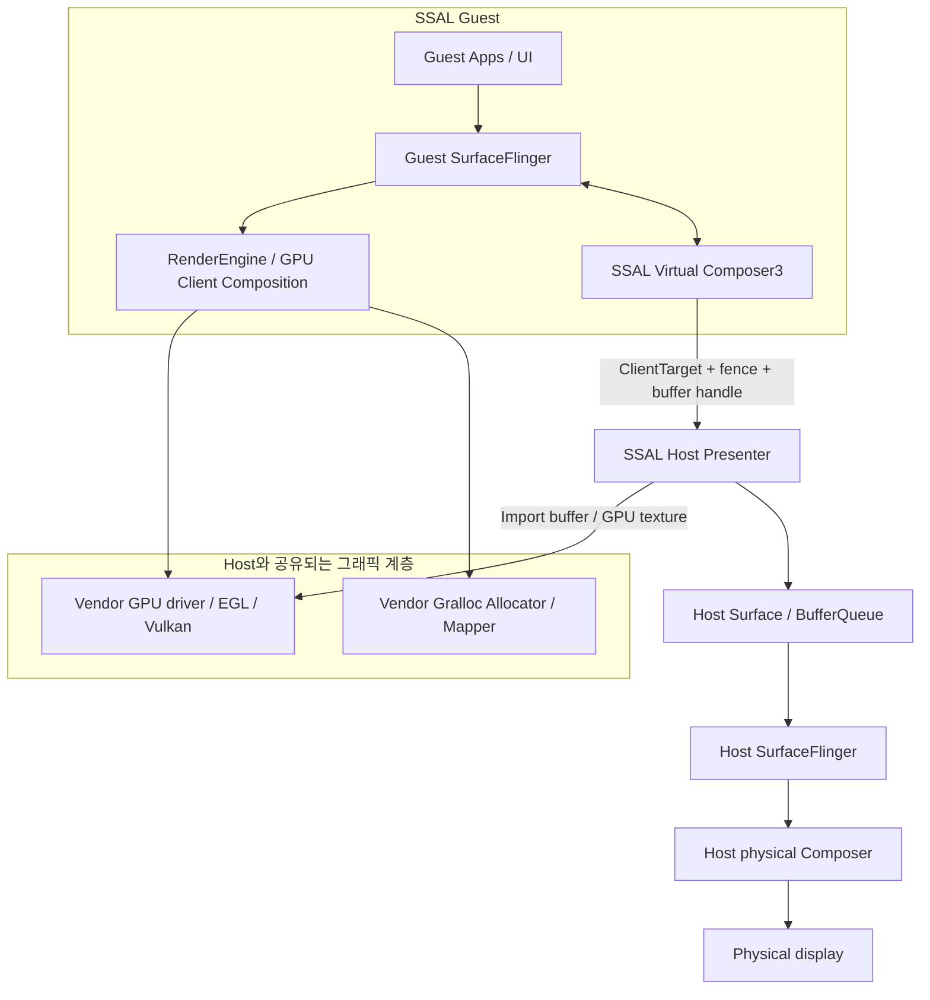

# SSAL 기술 조사: Host GPU/Gralloc 재사용 + Guest Composer 가상화

- **조사 기준일:** 2026-11-19
- **대상 프로젝트:** SSAL Core Runtime (Concurrent 모드 중심)
- **상태:** 아키텍처상 가능 / 삼성 Host GPU·Gralloc의 Guest 재사용은 미검증
- **범위:** Guest SurfaceFlinger의 Composer HAL만 가상화하고, Host GPU 드라이버 및 그래픽 버퍼 할당 계층을 재사용하여 최종 프레임을 SSAL Host Presenter로 전달할 수 있는지

> **핵심 판정**
>
> Host GPU·Gralloc과 Guest Composer를 **논리적으로 분리하는 것은 AOSP 그래픽 구조상 가능**하다. Guest 전용 Composer는 물리 디스플레이 대신 가상 Primary Display를 제시하고, Guest SurfaceFlinger의 GPU Client Composition 결과(`ClientTarget`)를 Host Presenter로 전달할 수 있다. 다만 **실제 삼성 vendor GPU 드라이버·Allocator·Mapper를 Guest 컨텍스트에서 재사용할 수 있는지는 아직 확인되지 않았다.** 따라서 현재 단계에서 SSAL의 구현 성공을 보장할 수는 없다.

## 1. 조사 질문과 결론

**질문:** Host GPU/Gralloc을 재사용하면서 Guest Composer만 가상화할 수 있는가?

**답:** 아키텍처상 **예**. 역할이 다른 계층이므로 함께 가상화할 필요는 없다.

| 계층 | 역할 | SSAL 목표 |
|---|---|---|
| GPU kernel driver / EGL / GLES / Vulkan | GPU 렌더링 및 디바이스 접근 | Host 드라이버·자원 재사용 (조건부) |
| Gralloc `IAllocator` | GraphicBuffer 할당 | Host vendor allocator 재사용 (미검증) |
| Gralloc `IMapper` | 버퍼 import, metadata, CPU 접근 등 | Host vendor mapper 재사용 (미검증) |
| Composer3 (`IComposer`) | 디스플레이 상태 및 합성 제어 | **Guest 전용 가상 Composer 구현** |
| SurfaceFlinger | 레이어 합성, 디스플레이 프레임 생성 | Host와 Guest 각각 유지 |
| SSAL Host Presenter | Guest 최종 프레임 표시 | Guest 버퍼 수신 및 Host Surface에 표시 |

중요한 경계는 **실제 GPU 공유**와 **Host 디스플레이 제어권 공유**를 혼동하지 않는 것이다. Host SurfaceFlinger와 실제 디스플레이 Composer는 계속 Host가 소유한다. Guest에는 별도의 논리적 디스플레이를 제공한다.

## 2. 목표 아키텍처



위 도식의 `ClientTarget` 전달 경로는 **구현 목표**이지 현재 SSAL에서 완료된 경로가 아니다. 실제 데이터 경로를 성립시키려면 버퍼 handle, 메타데이터, fence, 생명주기 및 접근 권한을 함께 다루어야 한다.

## 3. 물리 디스플레이 없이 Guest SurfaceFlinger 구동

### 3.1 기본 디스플레이 초기화의 제약

AOSP SurfaceFlinger는 초기 물리 디스플레이 구성 및 primary display 존재 여부를 확인하는 경로가 있다. 따라서 **Composer가 디스플레이를 전혀 보고하지 않는 구성**은 Guest의 정상적인 기본 화면 초기화에 적합하지 않다.

Guest Composer는 실제 패널이 없어도 다음과 같은 **가상 Primary Display**를 SurfaceFlinger에 제공하도록 설계한다.

```text
Display:  SSAL Virtual Primary
Type:     Internal (논리적 분류)
State:    Connected
Mode:     1080 x 1920 @ 60 Hz (예시값)
Output:   Guest client target → SSAL Host Presenter
```

필요한 기능의 예시는 hotplug 통지, 디스플레이 구성/모드 조회, VSync·present 동기화, 전원 상태, Composer3 validate/present 명령 처리이다. 정확한 필수 항목은 해당 Android 버전의 AIDL Composer 계약과 실제 SurfaceFlinger 호출 경로에 맞춰 확인해야 한다.

### 3.2 AOSP `VirtualDisplay`와의 차이

| 항목 | Android 일반 VirtualDisplay | SSAL 가상 Primary Display |
|---|---|---|
| 생성 지점 | SurfaceFlinger / DisplayManager의 가상 디스플레이 경로 | Composer HAL의 물리 디스플레이 모델 및 hotplug 경로 |
| 사용 목적 | 추가 출력·캡처·미러링 등 | Guest의 최초/기본 UI 표시 |
| 실제 물리 패널 | 불필요 | 불필요 |
| 부팅 시 기본 화면 역할 | 별도 기본 디스플레이 전제가 문제가 될 수 있음 | Guest의 기본 화면으로 제시하도록 설계 |

핵심은 **가상 디스플레이를 '물리 장치'로 구현한다는 의미가 아니라, HAL 계약상 기본 디스플레이처럼 보이게 한다는 의미**다.

## 4. 재사용 가능한 AOSP 구현체

### 4.1 Goldfish HWC3

- 소스 디렉터리: <https://android.googlesource.com/device/generic/goldfish-opengl/+/refs/heads/main/system/hwc3/>
- `ClientFrameComposer.cpp`: <https://android.googlesource.com/device/generic/goldfish-opengl/+/refs/heads/main/system/hwc3/ClientFrameComposer.cpp>

Goldfish HWC3에는 `HostFrameComposer`, `GuestFrameComposer`, `ClientFrameComposer`, `NoOpFrameComposer` 등의 백엔드가 있다. **SSAL과 가장 유사한 패턴은 `ClientFrameComposer`**다.

그 핵심 흐름은 다음과 같다.

1. 레이어별 composition type을 `CLIENT`로 유도한다.
2. SurfaceFlinger RenderEngine이 GPU로 Client Composition을 수행한다.
3. Composer는 `ClientTarget` 그래픽 버퍼와 fence를 획득한다.
4. Goldfish 기존 구현은 해당 결과를 DRM 출력 경로로 보낸다.
5. SSAL은 DRM 출력 단계 대신 **Host Presenter로 전송하는 전용 백엔드**를 구현한다.

관련 호출·처리 패턴:

```cpp
// 개념적 핵심 흐름: 실제 패치 코드가 아님
// validateDisplay: GPU Client Composition 강제
// setClientTarget: 결과 버퍼 핸들 및 acquire fence 수신
// presentDisplay: 최종 버퍼를 Presenter 경로로 큐잉
```

**주의:** Goldfish의 HWC3를 그대로 삼성 기기에서 실행할 수 있다는 뜻은 아니다. DRM 디스플레이 탐색·버퍼 플러시·장치 초기화 부분은 SSAL에 맞게 수정해야 한다. 또한 `NoOpFrameComposer`만으로는 Primary Display와 실제 프레임 출력을 제공할 수 없다.

### 4.2 예상 재사용 영역

| 기존 코드/패턴 | 재사용 가능성 | 필요한 SSAL 작업 |
|---|---|---|
| Composer3 AIDL 서버 구조 | 높음 | Guest private service 등록·SELinux 연계 |
| ComposerClient 명령 파싱 | 높음 | 해당 GSI 버전의 계약 호환성 확인 |
| validateDisplay / CLIENT 변경 처리 | 높음 | Guest 버퍼 형식에 맞게 수정 |
| setClientTarget / presentDisplay 경로 | 높음 | FD/fence 전달 및 버퍼 생명주기 관리 |
| DRM 기반 디스플레이 discovery | 낮음 | 가상 Primary Display 공급자로 대체 |
| DRM scanout / flush | 낮음 | SSAL Host Presenter 출력으로 대체 |

## 5. 핵심 미검증: Host Gralloc/GPU를 Guest에서 정말 쓸 수 있는가?

Composer만 독립시키는 설계와, Guest가 Host vendor 그래픽 스택을 실제로 사용할 수 있다는 주장은 별개다.

### 5.1 Gralloc5의 서비스 의존성

Gralloc5는 AIDL `IAllocator` 서비스를 조회하고, 별도의 vendor mapper 구현을 사용하는 경로를 갖는다. Guest가 **자체 Private ServiceManager**를 사용하는 SSAL에서는 Host의 allocator가 이미 떠 있어도 Guest 서비스 탐색에 자동으로 나타나지 않는다.

Guest ANGLE 초기화 시 `GraphicBufferMapper` → `Gralloc5` → `AServiceManager_isDeclared()` → `servicemanager.ready` 대기가 발생했던 SSAL 선행 관측은 바로 이 경계의 중요성을 보여준다.

선택지는 다음과 같다.

| 방식 | 장점 | 위험·부담 |
|---|---|---|
| Guest에서 Host allocator 서비스 직접 조회 | 구현 단순화 가능 | Binder namespace·접근 권한·서비스 발견 보장 필요 |
| Guest allocator 프록시 → Host allocator | 격리 경계를 명시적으로 유지 가능 | AIDL 중계, native handle/fence, 오류 처리 구현 필요 |
| Guest vendor allocator 별도 인스턴스 | 독립 프로세스 모델 | HAL 다중 인스턴스·드라이버 초기화 안전성 불명 |
| Software Gralloc / renderer | 초기 진단 환경 구성 용이 | 질문의 Host GPU/Gralloc 공유 검증은 아님 |

**Composer 프록시, allocator 프록시, mapper 로딩은 다른 문제**다. AIDL allocator와 프로세스 내 Mapper의 형태 및 ABI도 구별해야 한다.

### 5.2 Hardware GPU 검증 필수

Guest에서 EGL/GLES가 초기화되었다는 사실만으로 HW GPU 재사용이 입증되지는 않는다. 다음을 확인해야 한다.

- EGL renderer/vendor 문자열 및 로드된 실제 GPU 라이브러리
- GPU device node 접근과 ioctl 결과
- GPU 렌더링이 software fallback이 아닌지
- Host·Guest 동시 렌더링 중 드라이버 안정성과 메모리 압박
- Binder / SELinux / cgroup / namespace 조건

SSAL의 기존 4×4 RGBA8 RED 전송 성공은 **Unix 소켓·픽셀 경로의 기초 검증**이지, Host 하드웨어 Gralloc 또는 GPU 직접 재사용의 증거는 아니다.

## 6. 최종 버퍼 전달 방식

### 6.1 예상 데이터 경로

```text
Guest SurfaceFlinger
  └─ RenderEngine GPU Client Composition
       └─ ClientTarget native graphics buffer + acquire fence
            └─ SSAL Virtual Composer
                 └─ Unix domain socket (buffer handles/FDs + fence + metadata)
                      └─ SSAL Host Presenter
                           └─ Buffer import → EGLImage / GPU texture
                                └─ Host Surface → Host SurfaceFlinger
```

Android NDK는 버퍼 핸들을 Unix socket으로 주고받는 API를 제공한다.

- `AHardwareBuffer_sendHandleToUnixSocket()`
- `AHardwareBuffer_recvHandleFromUnixSocket()`
- Android NDK 문서: <https://developer.android.com/ndk/reference/group/a-hardware-buffer>

Host Presenter가 받는 버퍼를 GPU에서 사용하려면 EGL/GraphicBuffer와의 연계, pixel format 및 usage 호환성을 검증해야 한다.

### 6.2 'Zero-copy'에 대한 정확한 해석

하드웨어 버퍼의 **핸들/FD를 전달**하면 전체 RGBA 데이터를 CPU로 왕복 복사하지 않는 경로를 목표로 할 수 있다. 다만 다음까지 보장하는 것은 아니다.

- GPU가 Host Surface에 그리는 비용이 0이라는 뜻은 아니다.
- Host SurfaceFlinger의 추가 합성 비용이 사라지지 않는다.
- format mismatch 또는 보호된 버퍼는 추가 변환·제약이 있을 수 있다.
- 버퍼 handle 공유만으로 GPU 완료/읽기 완료 동기화가 해결되지는 않는다.

### 6.3 반드시 구현할 동기화·생명주기

- `ClientTarget` 소유권 및 참조 유지
- acquire fence 대기/전달
- Present 완료와 release fence 의미 정의
- buffer cache·재사용·폐기 시점
- Presenter 연결 종료, Guest stop 시 FD 누수 및 비정상 해제 방지
- Producer가 덮어쓰기 전에 Consumer가 사용을 끝냈는지 검증

이러한 계약을 누락하면 tearing, stale frame, 그래픽 손상, GPU hang 등의 위험이 있다.

## 7. 개발·검증 우선순위

| 단계 | 시험 | 통과 기준 | 상태 |
|---|---|---|---|
| P0 | Guest vendor Gralloc Mapper 초기화 | 로드·초기화·기본 metadata 조회 성공 | 미검증 |
| P1 | Guest에서 Host allocator 사용 | GPU용 RGBA 버퍼 할당/Mapper import 성공 | 미검증 |
| P2 | Guest HW GPU 렌더링 | 실제 vendor GPU/EGL을 통한 렌더링 입증 | 미검증 |
| P3 | Guest → Host native buffer 공유 | Host가 동일 버퍼를 import하여 픽셀 검증 | 미검증 |
| P4 | 가상 Composer Primary Display | Guest SF 초기화 및 기본 화면 인식 | 미검증 |
| P5 | ClientTarget 실프레임 출력 | Guest 합성 결과가 Presenter에 도달 | 미검증 |
| P6 | 지속 출력 | fence/재사용/누수/Host 영향 장시간 검증 | 미검증 |

**순서 권장:** P0~P3으로 먼저 하드웨어 공유 전제를 검증하고, 이후 Composer3의 디스플레이 프로토콜과 Host Presenter 연동을 본격화한다.

Composer를 먼저 만들어도 P0~P2에서 하드웨어 vendor 스택이 막히면 목표 성능·GPU 공유를 확보할 수 없기 때문이다.

## 8. Host 안전성 및 Concurrent 모드 적합성

| 항목 | 예상 판정 |
|---|---|
| Host SurfaceFlinger 계속 실행 | 가능하도록 설계 가능 |
| Host 실제 Composer 소유권 유지 | 가능 |
| Guest의 독립 디스플레이 설정·Hotplug | Guest Composer 내부에서 구현 가능 |
| Guest GPU 컨텍스트와 Host GPU 컨텍스트 공존 | vendor 드라이버 검증 필요 |
| Host/Guest GPU 메모리 자원 완전 격리 | 불가능 — 동일 하드웨어 자원 공유 |
| Guest Composer에서 Host 실제 패널 제어 | 하지 않음 |
| Protected content / DRM | 초기 범위에서 제외 권장 |
| GPU 장애·압박으로부터 Host 완전 보호 | 보장 불가 |

SSAL Concurrent 모드에는 **Host 실디스플레이 HAL을 건드리지 않고 Guest에 별도 디스플레이 의미론을 제공**한다는 점에서 매력적이다. 그러나 GPU 공유는 여전히 Host 안정성·SELinux·메모리·스케줄링 부담을 남긴다.

## 9. 대안 비교

| 설계 | 장점 | 한계 | SSAL 적합성 |
|---|---|---|---|
| 삼성 Host Composer 직접 공유 | 기존 실디스플레이 HAL 재사용 | Host 디스플레이 소유권 충돌 위험 | 낮음 (Concurrent) |
| AOSP VirtualDisplay만 이용 | 상위 API 재사용 | Guest의 부팅 초기 Primary Display 요구 해결 별도 필요 | 제한적 |
| **Goldfish HWC3 기반 가상 Primary Composer** | AIDL·Client Composition 패턴 재사용 | 디스플레이 discovery/output 백엔드 수정 | **우선 후보** |
| Composer3 완전 독자 구현 | 동작 제어 자유도 | AIDL 프로토콜·상태 머신 구현 부담 | 가능하나 비용 큼 |
| SwiftShader + 가상 Composer | 초기 검증 및 fallback | Host GPU 재사용 목표 아님 | 진단용 |

## 10. 최종 판단과 다음 액션

1. **Composer 계층만 별도로 가상화할 수 있다.** GPU, Gralloc, Composer는 Android 그래픽 스택에서 서로 다른 책임을 갖는다.
2. **가상 Primary Display가 필요하다.** Guest SurfaceFlinger의 초기 화면 구성에는 기본 디스플레이에 대응하는 HAL 경로가 요구된다.
3. **Goldfish HWC3의 ClientFrameComposer가 가장 실질적인 재사용 출발점이다.** DRM 출력 및 디스플레이 탐색은 SSAL 백엔드로 교체한다.
4. **삼성 Host GPU·Gralloc의 Guest 사용은 아직 검증되지 않았다.** Guest의 private ServiceManager와 vendor HAL/Mapper 의존성이 핵심 위험이다.
5. **다음 실험은 Guest native graphics buffer → Host import**가 합리적이다. HW GPU 렌더러와 vendor Gralloc을 실제로 사용했음을 함께 증명해야 한다.

### 간단한 에이전트 실험 지시 초안

> SSAL Concurrent 모드에서 Host SurfaceFlinger/실제 Composer를 정지하거나 변경하지 말고, Guest가 기존 vendor GPU/Gralloc로 RGBA 버퍼를 할당·GPU 렌더링한 뒤 SSAL Unix socket을 통해 Host 프로세스로 native handle 및 fence를 전달하고 Host에서 동일 버퍼를 import할 수 있는지 P0~P3 단계로 검증하라. 각 단계에서 GPU vendor/renderer, allocator/mapper 경로, Binder 서비스 접근, SELinux AVC, FD/fence 생명주기, Host 영향 여부를 기록하고, 우회 패치나 permissive 확장을 기본 경로에 영구 적용하지 말라. PASS를 확인하기 전에는 Composer3 구현 성공을 가정하지 말라.

## 11. 참고 코드 및 문서

1. AOSP Goldfish HWC3 디렉터리: <https://android.googlesource.com/device/generic/goldfish-opengl/+/refs/heads/main/system/hwc3/>
2. Goldfish ClientFrameComposer: <https://android.googlesource.com/device/generic/goldfish-opengl/+/refs/heads/main/system/hwc3/ClientFrameComposer.cpp>
3. Android HWC 개요: <https://source.android.com/docs/core/graphics/hwc>
4. Android Gralloc 및 BufferQueue 개요: <https://source.android.com/docs/core/graphics/arch-bq-gralloc>
5. Android NDK AHardwareBuffer: <https://developer.android.com/ndk/reference/group/a-hardware-buffer>
6. AOSP SurfaceFlinger 소스 트리: <https://android.googlesource.com/platform/frameworks/native/+/refs/heads/main/services/surfaceflinger/>
7. AOSP graphics Composer3 AIDL 소스: <https://android.googlesource.com/platform/hardware/interfaces/+/refs/heads/main/graphics/composer/aidl/>
8. AOSP Gralloc 구현(검색 시작점): <https://android.googlesource.com/platform/frameworks/native/+/refs/heads/main/libs/ui/>

---

**범위 및 신뢰도 주의:** 이 문서는 2026-11-19까지의 SSAL 대화에서 수행한 조사 결과를 Markdown으로 정리한 것이며, 새로운 기기 실험 결과가 아니다. AOSP의 구조적 가능성과 특정 기기에서의 실행 가능성을 구분해 읽어야 한다. 참고 링크 중 `main` 브랜치는 시점에 따라 코드가 변할 수 있어, 실제 구현 시에는 타깃 Android/GSI 버전에 맞는 커밋 또는 태그를 고정하여 재검증해야 한다.
