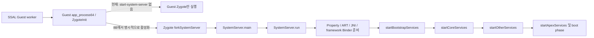

# Phase 8A — Guest `system_server` 의존성 분석

- 조사일: 2026-11-05 KST
- 범위: 저장소 코드, Phase 7I 결과, 지정된 LineageOS GSI 이미지의 읽기 전용 확인, AOSP Android 16 소스 참조
- 실행 금지 범위 준수: Guest `SystemServer.main()` 및 Host 서비스/HAL/property는 실행·변경하지 않았다.

## 판정 요약

Phase 7I의 Guest Property Service, Private Binder/AIDL, Guest Zygote fork, Java child 진입과 ext4 userdata 경로는 재사용할 수 있다. 하지만 현재 SSAL은 `--start-system-server`를 넘기지 않고, Zygote 실행 환경에서 `SYSTEMSERVERCLASSPATH`도 전달하지 않는다. 또한 검증된 SELinux fallback은 UID 10000의 probe 전용이어서 UID 1000의 `system_server` fork에 적용되지 않는다. 따라서 현재 실행 경로만으로는 `SystemServer.main()` 진입을 확인할 수 없다.

분석 기준은 GSI의 실제 파일 목록·속성과 AOSP 참조 소스다. GSI의 정확한 Lineage manifest/source commit은 작업 폴더에 없어 AOSP 코드를 이미지와 같은 빌드라고 단정하지 않는다.

## 대상 이미지

`out/LineageOS-23.2-20260524-VANILLA-EXT4-GSI.img`를 마운트하지 않고 WSL `debugfs` 조회로 확인했다.

| 항목 | 이미지에서 확인한 값 |
|---|---|
| 크기 / SHA-256 | 2,733,260,800 bytes / `7b9ba62e8b48b6e40432be949ae0858a8971175c79502550e74691222d3889ff` |
| Android / SDK | Android 16 / 36 (`sdk_full=36.1`) |
| Build ID / 보안 패치 | `BP4A.251205.006` / `2026-05-01` |
| fingerprint | `google/lineage_arm64_bvN4/generic_arm64:16/BP4A.251205.006/eng.andrew:userdebug/release-keys` |
| 빌드 유형 | `userdebug`, `ro.debuggable=0` |
| 이미지 빌드 날짜 | `2026-05-24 15:34:32 MSK` |

공식 빌드 번호 표는 `BP4A.251205.006`을 `android-16.0.0_r4`에 대응시킨다. 이 값만으로 GSI의 정확한 Lineage manifest나 프레임워크 commit을 확정하지 않는다. 아래 소스 링크는 Android 16 QPR2 AOSP 참조 브랜치다. ([AOSP build number](https://source.android.com/docs/setup/reference/build-numbers), [AOSP `SystemServer.java`](https://android.googlesource.com/platform/frameworks/base/+/android16-qpr2-release/services/java/com/android/server/SystemServer.java), [AOSP `ZygoteInit.java`](https://android.googlesource.com/platform/frameworks/base/+/android16-qpr2-release/core/java/com/android/internal/os/ZygoteInit.java))

이미지에서 `/system/bin/app_process64`, `/system/bin/servicemanager`, `/system/bin/installd`, `/system/bin/keystore2`, `/system/lib64/libandroid_servers.so`, `/system/framework/services.jar`, `/system/framework/framework.jar` 및 `/system/apex`의 ART/runtime 등 APEX 파일을 확인했다. 파일 존재만으로 APEX 활성화, 서비스 기동, Java classpath 완전성 또는 Host 호환성을 증명하지 않는다.

## 시작 경로와 지금의 차이

현재 실행 코드와 검증 위치:

- `src/guest_launcher.rs::derive_guest_classpath()`는 Guest `derive_classpath`를 호출한다. `classpath_exports()`는 `BOOTCLASSPATH`와 `DEX2OATBOOTCLASSPATH`만 반환하고 `SYSTEMSERVERCLASSPATH`는 무시한다. `src/guest_probe.rs::root_command()`는 `env_clear()`를 호출하므로 Host 환경변수에서 우연히 상속되지도 않는다. 현재 Guest Zygote 환경에는 이를 다시 넣는 코드가 없다. AOSP `ZygoteInit`은 `SYSTEMSERVERCLASSPATH`로 system-server class loader를 만든다. 8B 전에 GSI에서 계산한 Guest 값으로만 이 환경을 추가해야 한다. ([classpath 파서](../src/guest_launcher.rs#L615), [classpath 파생](../src/guest_launcher.rs#L644), [Guest env 초기화](../src/guest_probe.rs#L296), [Zygote launch](../src/guest_launcher.rs#L1088))
- 현재 인자는 `--zygote --socket-name=zygote`이며 로그에도 `start_system_server=false`라고 남긴다. 이 경로가 Guest `init.zygote64.rc`를 실행하거나 Host init에 등록되지는 않는다. ([Guest Zygote 인자](../src/guest_launcher.rs#L1117))
- Profile은 `launch_enabled=false`이고 `ssald`는 `switch`와 `return`을 거부한다. `prepare`/worker와 별개로, 이번 Phase에서 일반 전환 경로는 열린 상태가 아니다. ([서비스 계약](../src/service_contract.rs#L121), [초기 계약](../module/profiles/services/initial.json), [`ssald` 차단](../src/ssald.rs#L376))

## AOSP 시작 구간과 필수 입력

| 구간 | 코드에서 확인되는 작업 | 8B 최초 진입에 필요한 Guest 입력 |
|---|---|---|
| GSI init 설정 | 실제 이미지 `/system/etc/init/hw/init.zygote64.rc`는 `app_process64 ... --zygote --start-system-server`, root/root, `readproc reserved_disk`, priority `-20`, `critical`, ProcessCapacityHigh/MaxPerformance를 설정한다. `onrestart`에는 power sysfs 쓰기 및 audio/camera/media/netd/wifi 재시작이 포함된다. | 이 rc를 Host init에 전달하지 않는다. SSAL worker에서 Zygote를 직접 실행하고 서비스 상태·재시작·정리를 소유한다. 이미지 `/init.environ.rc`의 `/system`, `/data`, `/storage`, ART/i18n/tzdata 경로를 Guest 환경으로 재현한다. |
| Zygote fork | AOSP `ZygoteInit.startSystemServer()`가 `Zygote.forkSystemServer()`를 부르고 child에서 `handleSystemServerProcess()`를 거쳐 Java class를 찾는다. | Guest Private Binder와 Guest Zygote socket, ABI/SDK/codename property, Guest linkerconfig/APEX, Guest boot/system-server classpath, 전용 SELinux target. 현재 system-server 시작 인자는 없다. |
| `SystemServer.main()` / `run()` 진입 | Java entrypoint 이후 Perfetto 초기화, system-server 시작 정보를 property에 기록, EventLog/timezone/locale, `android_servers` JNI 로드, SystemContext 및 ServiceManager 등록 후 bootstrap으로 이동한다. | Guest Property Service와 Guest property contexts, `libandroid_servers.so`, Guest framework Binder, system-server class loader, `/system` 리소스, private service registry가 필요하다. Phase 7I는 시험 key/property와 AIDL child를 통과했지만 이 코드 경로를 호출하지 않았다. |
| Bootstrap | `startBootstrapServices()`에서 Activity/Package/Installer, Power/Thermal, Lights, DisplayManager 및 User/기본 서비스들이 상호 의존 순서로 시작된다. Power/Display/Storage/HAL 조회가 실제로 부작용이 없는지는 서비스별로 다르다. | Guest 전용 servicemanager, `installd`/`artd`, Guest `/data`, process/cgroup 계약. Host power/display/storage/security HAL은 직접 연결하지 않는다. 필요한 Guest 기능만 후속 relay 후보로 둔다. |
| Core / Other / APEX | Battery/Health, Usage, WebView 등 이후 Core 단계. WindowManager, StorageManager, Network, LockSettings/Keystore 및 다른 서비스가 Other/APEX/boot phase에 더해진다. | 완전 부팅을 이번 단계 목표로 삼지 않는다. 첫 Bootstrap 호출 이전에 요구되지 않는 HAL·UI·FBE는 8B 최초 성공 조건에 넣지 않는다. |

`SystemServiceManager.startService()`는 각 서비스의 `onStart()` 예외를 다시 던지고 boot phase도 순차 전달한다. `SystemServer.run()`은 서비스 시작의 `Throwable`을 기록하고 다시 던진다. 다만 개별 서비스가 예외를 잡아 `reportWtf()`로 계속 진행하는 경우도 있어 HAL 하나가 없다고 항상 전체 process가 즉시 종료한다고 단정할 수 없다. ([AOSP `SystemServiceManager.java`](https://android.googlesource.com/platform/frameworks/base/+/android16-qpr2-release/services/core/java/com/android/server/SystemServiceManager.java), [AOSP `SystemService.java`](https://android.googlesource.com/platform/frameworks/base/+/android16-qpr2-release/services/core/java/com/android/server/SystemService.java))

## UID, capability, rlimit, property

- GSI init rc의 Zygote는 UID/GID 0/0으로 시작한다. system_server는 Zygote fork에서 Android 시스템 사용자 UID/GID 1000/1000으로 specialize하고, AOSP branch가 정한 supplementary groups와 capability mask를 요청한다. capability는 Zygote의 실제 유효 capability 집합과 fork specialization의 영향을 받으므로 GSI 바이너리의 최종 `CapEff`를 코드 목록만으로 확정하지 않는다.
- GSI Zygote rc에는 별도 `rlimit` 항목이 없다. 현재 SSAL `Service::start()`도 system_server rlimit을 지정하지 않는다. 따라서 8B에서 실제 child의 `RLIMIT_NOFILE`, `RLIMIT_CORE`, stack/as 값과 `CapEff/CapBnd`를 `/proc/<pid>/limits` 및 `/proc/<pid>/status`로 기록해야 한다. 현 기기의 값은 **UNKNOWN**이다.
- AOSP `SystemServer.run()`은 `sys.system_server.start_count`, elapsed/uptime property와 `persist.sys.dalvik.vm.lib.2` 등을 일찍 기록한다. 이후 boot-complete property도 Guest init이 존재하면 trigger가 될 수 있다. 현재 SSAL은 Guest Property Service와 persistent storage를 Guest에 두고 `forward_ctl=false` 계약을 둔다. Phase 7I에서 `sdk`, 시험 volatile/persistent key는 확인했지만 모든 framework property context는 검증하지 않았다. `sys.powerctl`과 `ctl.*`은 Guest area 안에서만 처리되어야 한다. ([Property Service start](../src/guest_launcher.rs#L681), [Guest property identity check](../src/guest_launcher.rs#L714))

## 서비스 및 HAL 의존성 우선순위

| 서비스/장치 | 최초 Java entrypoint | Bootstrap/Core 이후 | 8B 정책 |
|---|---|---|---|
| Private `servicemanager` / framework Binder | `SystemServer`의 `ServiceManager.addService()`부터 사용 | 서비스 등록/조회 지속 | Guest `/dev/binder` 경로는 Private로 검증됐지만, Java `SystemServer` context와 실제 system service 등록은 미검증. Guest registry만 사용한다. |
| `ActivityManagerService` | 진입 전 불필요 | Bootstrap 핵심. process, zygote, package, cgroup 및 `/proc` 관리 | Guest child만 추적하도록 한다. Host PID/FD/신호 경계는 별도 항목으로 검증한다. |
| `PackageManagerService` / `installd` / `artd` | 진입 전 불필요 | Bootstrap 중 display/installer 준비 뒤 PMS 시작 및 package/dex 사용 | Phase 6B의 Guest installd create/delete와 artd 시험은 별도 세션 증거다. Phase 7I 전체 fork 세션에서 PMS startup 계약을 증명하지 않는다. Guest `/data`만 사용한다. |
| Power / Thermal / Lights | Java entrypoint에는 불필요 | Bootstrap에서 시작. 일부 경로는 power, suspend, thermal, lights HAL 또는 device node를 조회 | Host HAL 직접 접근은 막는다. 8B 최초 단계는 부팅에 필요한 범위만 관찰한다. |
| DisplayManager / SurfaceFlinger / WindowManager | Java entrypoint에는 불필요 | DisplayManager는 Bootstrap, WindowManager는 뒤 단계. display readiness 대기 가능 | GSI에 SF 바이너리가 있어도 Guest SF/HWC가 기동된 증거는 없다. Host HWC/display를 열지 않는다. Headless 시작은 UNKNOWN이며 첫 실패로 기록한다. |
| Health/AIDL HAL | Java entrypoint에는 불필요 | Battery/Health Core 단계 | Host HAL service를 Guest binder에서 찾을 수 없다. 실제 필수 시점까지 차단하고 relay 구현은 보류한다. |
| keystore2 / KeyMint / Gatekeeper | Java entrypoint에는 불필요 | LockSettings/보안 서비스에서 호출 가능 | GSI keystore2 바이너리의 존재는 Guest 서비스나 Guest 키 분리를 뜻하지 않는다. Host 보안 HAL/key 경로는 차단한다. |
| Network, Radio, Camera, Audio, Sensor | Java entrypoint에는 불필요 | Other/feature-specific 단계에서 사용 | Guest `/dev/hwbinder`, `/dev/vndbinder`, Host socket/장치 direct bind는 차단한다. 정말 필요한 인터페이스만 relay 후보로 분류한다. |

GSI `SYSTEMSERVERCLASSPATH`와 Host에서 상속한 classpath를 혼용하지 않는 것, Guest `system_server`의 전용 SELinux type, 공유 PID의 Host process 경계를 검증하는 것이 첫 Bootstrap 시도보다 앞선 구현 항목이다. 나머지 미구현 HAL 전체를 Phase 8B의 선행조건으로 만들지 않는다.

## 참고 코드 및 결과

- SSAL 실행·classpath: [`guest_launcher.rs`](../src/guest_launcher.rs), [`guest_probe.rs`](../src/guest_probe.rs), [`guest_mounts.rs`](../src/guest_mounts.rs)
- 최신 PoC: [Phase 7I 통합](guest-property-supervisor-integration.md), [Phase 7F-C Java fork 결과](zygote-phase7fc-results.md), [Guest 서비스 Phase 6B 결과](guest-services-phase6b-results.md)
- 기존 분석의 Phase 7I 이전 결론은 [역사 문서](system-server-static-analysis.md)로 남아 있다.
