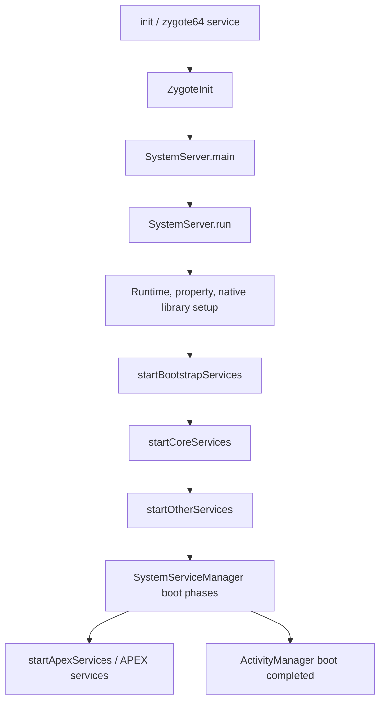

# Android 16 `system_server` 정적 분석 — SSAL / LineageOS 23.2

- 조사일: 2026-11-04
- 범위: 읽기 전용 소스·이미지 정적 분석. Guest `system_server` 실행, Host 서비스/HAL 조작, 정책 변경, SSAL 수정은 하지 않았다.
- 판정 기준: `SAFE`는 격리된 실행 경로가 근거로 확인된 경우에만 쓴다. `UNKNOWN`은 안전하다는 뜻이 아니다.

## 1. Executive Summary

**현재 SSAL에서 Android 16 LineageOS `system_server`를 Host One UI에 영향을 주지 않게 실행할 조건은 아직 충족되지 않았다.** 현재 코드와 검증은 `system_server` 실행을 의도적으로 막는다. `launch_enabled=false`이며 `switch`와 `return`도 거부된다. 공유 PID 조사는 완료했고 PID namespace 부재는 blocker가 아니다. 아직 private property/framework Binder, 실행 런처·cgroup 경로와 HAL 조건이 검증되지 않았다.

아키텍처상 실행이 불가능하다고 증명된 것은 아니다. Private Binder 하나만으로는 충분하지 않다. 별도 Property Service, 게스트 전용 데이터와 서비스 등록소, Host Binder/HAL/전역 장치 상태를 향하지 않는 호출 경로, 제한된 FD·mount·cgroup 접근, 게스트 서비스 도메인을 모두 준비하고 확인해야 한다. 현재 마운트 프로필은 Guest `/dev`와 cgroup 경로를 전용·미노출로 구성하지만, cgroup 미노출 상태에서 Android process-group 기능도 동작한다고 검증된 것은 아니다. 특히 Power·Display·Storage·Keystore 계열은 Host 상태에 닿을 수 있으므로 직접 연결을 차단하거나 인터페이스별 중계를 만들기 전에는 실행하면 안 된다.

**현재 근거로 답할 수 있는 최종 조건**은 이 문서의 [결론](#12-필수-조건과-최초-실기기-실험)에 정리했다. 가장 안전한 첫 실기기 단계는 `system_server` 없이 Guest Zygote만 올리는 Stage A다. Stage B 이후는 차단 조건이 해소된 뒤 별도 승인을 받아야 한다.

## 2. 분석 대상과 버전

### 이미지에서 직접 확인한 정보

사용자가 지정한 `out/LineageOS-23.2-20260524-VANILLA-EXT4-GSI.img`를 읽기 전용으로 확인했다. 이미지를 마운트하거나 수정하지 않았다.

| 항목 | 관측값 |
|---|---|
| 크기 / SHA-256 | 2,733,260,800 bytes / `7B9BA62E8B48B6E40432BE949AE0858A8971175C79502550E74691222D3889FF` |
| Android / API | Android 16 / SDK 36, `sdk_full=36.1` |
| Build ID / 보안 패치 | `BP4A.251205.006` / 2026-05-01 |
| 제품 / fingerprint | `lineage_arm64_bvN4`; `google/lineage_arm64_bvN4/generic_arm64:16/BP4A.251205.006/eng.andrew:userdebug/release-keys` |
| 빌드 속성 | `ro.build.type=userdebug`, `ro.debuggable=0` |
| 이미지 날짜 | 2026-05-24 15:34:32 MSK |

`BP4A.251205.006`은 Android 16 QPR2 계열이다([공식 Android build-number 안내](https://source.android.com/docs/setup/reference/build-numbers)). 정확한 GSI 소스 revision과 `.repo/manifest.xml`은 작업 폴더에 없어 이미지와 소스 commit을 일대일로 고정하지 못했다. 따라서 아래 Android 프레임워크 설명은 [AOSP `android16-qpr2-release`](https://android.googlesource.com/platform/frameworks/base/+/android16-qpr2-release/services/java/com/android/server/SystemServer.java)와 LineageOS 23.2 소스 구조를 기준으로 한다. 현재 Lineage 브랜치의 이후 commit을 이미지와 동일한 소스로 간주하지 않는다.

로컬 [`vendor/LineageOS_gsi/README.md`](../vendor/LineageOS_gsi/README.md)는 LineageOS `lineage-23.2`와 `MisterZtr/treble_manifest`를 사용하는 GSI 빌드 경로를 기술한다. 이는 소스 계보의 단서이지, 제공된 바이너리의 정확한 manifest 증명은 아니다. 이미지 안에는 `init.zygote64.rc`, `servicemanager.rc`, `surfaceflinger.rc` 등이 있으며 파일 목록만으로 모든 APEX·서비스가 실제 활성화된다고 보지는 않는다.

삼성 쪽은 `vendor/S937NKSU2BYI3`의 커널 소스를 선택적으로 확인했다. [`gki_defconfig`](../vendor/S937NKSU2BYI3/kernel_platform/msm-kernel/arch/arm64/configs/gki_defconfig#L39)에서 `CONFIG_PID_NS`는 꺼져 있고 Binder IPC/BinderFS와 SELinux는 켜져 있다(각각 627–628, 721행). 소스 트리의 설정이며 현재 부팅된 기기의 모든 설정을 증명하지는 않는다. Host의 실제 One UI vendor 이미지, init 서비스 그래프와 활성 SELinux policy는 확인하지 못했다.

## 3. `system_server` 초기화 흐름

아래는 주요 흐름이다. 서비스 등록은 단순 객체 생성으로 끝나지 않는다. 각 서비스의 `onStart()`와 이후 boot-phase callback은 Binder 등록, 파일 I/O, native 코드 및 HAL 조회를 동기적으로 수행할 수 있다.

### 주요 단계와 외부 의존성

| 단계 | 소스 위치와 주요 작업 | Host 영향 경로 / 실패 양상 |
|---|---|---|
| Zygote 시작 | 이미지 `system/etc/init/hw/init.zygote64.rc`: `/system/bin/app_process64 ... --zygote --start-system-server` | 이 init service를 Host init이 읽으면 Host init이 Zygote와 system_server를 관리하게 된다. SSAL은 Guest init을 실행하지 않으므로 별도 supervisor가 같은 명령을 그대로 재사용해서는 안 된다. |
| `SystemServer.main()` → `run()` | AOSP `services/java/com/android/server/SystemServer.java`: `main`, `run`; ART runtime, `android_servers` JNI 라이브러리와 서비스 준비 | 초기화 과정에서 property, EventLog, timezone/locale 및 native 서비스 경로를 건드린다. 예외·초기화 실패는 런타임 종료나 부팅 정체로 이어질 수 있다. |
| Bootstrap | `startBootstrapServices()`: Installer, ActivityManager, DataLoader/Incremental, PowerManager, Thermal, Lights, DisplayManager, Recovery, Sensor 등 | 프로세스·스토리지·전력·디스플레이·센서 의존성이 집중된다. Host 경로/HAL을 그대로 쓰면 Guest namespace 밖의 상태를 만질 수 있다. |
| Core | `startCoreServices()`: SystemConfig, Battery, Usage, WebView 및 진단/업데이트 관련 서비스 | 구성 파일과 APEX·패키지 메타데이터를 읽는다. 누락·버전 불일치는 뒤 단계 서비스 실패로 전파될 수 있다. |
| Other | `startOtherServices()`: Alarm, Input, Camera, WindowManager, StorageManager, Network, Wi-Fi, Notification, Location, Audio 등 | 다수는 장치/HAL, system service Binder, vold 또는 Host가 소유하는 전역 커널 자원에 의존한다. GSI와 삼성 Host가 모두 제공하는 이름을 공유 ServiceManager에 조회하는 것도 위험하다. |
| Boot phase | `SystemServiceManager.startService()`가 `onStart()`를 부르고, 이후 `onBootPhase()`를 순차 전달한다. 예외는 서비스 시작/부팅 진행을 중단할 수 있다. | 일부 서비스는 `WAIT_FOR_DEFAULT_DISPLAY`, `SYSTEM_SERVICES_READY`, `THIRD_PARTY_APPS_CAN_START` 등의 단계가 오기 전까지 대기하거나 필수조건을 검사한다. |
| 완료 | `ActivityManagerService.finishBooting()` 및 BootCompleted phase. AMS는 boot-completed 상태와 관련 property를 기록한다. | `sys.boot_completed`, `dev.bootcomplete`가 Host property 영역으로 향하면 Host init/서비스가 Guest 상태를 Host 부팅 완료로 오인할 수 있다. |

주요 AOSP 위치: [`SystemServer.java`](https://android.googlesource.com/platform/frameworks/base/+/android16-qpr2-release/services/java/com/android/server/SystemServer.java)의 `main`, `run`, `startBootstrapServices`, `startCoreServices`, `startOtherServices`, `startApexServices`; [`SystemServiceManager.java`](https://android.googlesource.com/platform/frameworks/base/+/android16-qpr2-release/services/core/java/com/android/server/SystemServiceManager.java)의 `startService`와 `startBootPhase`; [`SystemService.java`](https://android.googlesource.com/platform/frameworks/base/+/android16-qpr2-release/services/core/java/com/android/server/SystemService.java)의 phase callback; [`ActivityManagerService.java`](https://android.googlesource.com/platform/frameworks/base/+/android16-qpr2-release/services/core/java/com/android/server/am/ActivityManagerService.java)의 `finishBooting`.

## 4. 서비스별 위험·의존성 분류

분류는 GSI의 실제 Host 연결 시험이 아니라 소스와 현재 SSAL 구조를 기준으로 한다. `OPTIONAL`은 완전 부팅의 목표에서 뺄 후보이며, 이미지별 의존성 확인 없이 안전하다는 뜻으로 쓰지 않았다.

| 서비스 / 단계 | Binder | HAL·파일·property 의존성 | 등급 및 이유 / 필요한 대응 |
|---|---|---|---|
| SystemServer 초기화 및 property 접근 | framework ServiceManager 이전에도 native/property 경로 사용 | `/dev`, property area/socket, system 설정 | **BLOCKED** — 전용 property server와 area가 없다. Host property API에 연결하지 않게 해야 한다. |
| `servicemanager`, framework registry | 기본 framework Binder | `/dev/binder` 및 서비스 컨텍스트 | **BLOCKED** — 전용 Binder 장치만으로 Java framework가 private context를 쓴다는 증거는 없다. Host registry 양방향 격리와 Java 클라이언트 검증 필요. |
| Installer / AMS / PackageManager / ART | framework Binder, zygote 및 서비스 호출 | Guest `/data`, installd/artd, package state, process/cgroup 제어 | **UNKNOWN** — Phase 2에서 일부 Guest installd/artd RPC를 봤지만 full PackageManager boot·FBE·system_server 경로는 검증되지 않았다. Guest userdata와 PID/프로세스 실행 계약을 먼저 완성해야 한다. |
| PowerManager / Thermal / Lights | framework 및 HAL Binder | 전력·thermal·wake lock·장치 노드 | **BLOCKED** 직접 Host HAL 연결. 인터페이스별 proxy와 부작용·복원 검증 전에는 조회도 보장되지 않는다. |
| DisplayManager / WindowManager / SurfaceFlinger | framework Binder, graphics/HWC | HWC, `/dev/graphics`, display sysfs, 전원 상태 | **BLOCKED** 물리 display 제어. headless 경로도 현재 GSI/HWC 조합에서 확인되지 않았다. |
| Input / Sensor / Camera / Audio | framework·HAL Binder | input, sensor, camera, audio 장치와 전역 세션 | Host 인스턴스 직접 연결은 **BLOCKED**; virtual/게스트 대체 경로는 **UNKNOWN**. 초기 목표에서 일부는 **OPTIONAL** 후보지만 구체적인 부팅 의존성 확인 전에는 제거 가능하다고 단정하지 않는다. |
| StorageManager / vold / LockSettings / Keystore / Gatekeeper | framework 및 HAL Binder | `/data`, `/metadata`, `/mnt`, fscrypt/FBE, KeyMint 등 | **BLOCKED** — Guest 데이터·키 수명주기와 Host 볼륨/보안 HAL의 분리가 증명되지 않았다. 기존 Host 키나 userdata를 쓰지 않도록 해야 한다. |
| Network / Wi-Fi / Radio / Location | framework 및 HAL Binder | netd, wificond, radio, netlink, 전역 네트워크 설정 | Host 네트워크/라디오 직접 제어는 **BLOCKED**. 인터페이스별 broker 또는 생략 여부는 **UNKNOWN**. |
| SystemConfig / APEX 서비스 | Binder 및 APEX manager | system/product/vendor 설정, APEX mount와 data | **UNKNOWN** — 이미지의 APEX 파일 목록은 활성화·서비스 호환성 증거가 아니다. guest apexd와 버전별 구성 검증이 필요하다. |

이 목록에서 **현재 증거만으로 무조건 `SAFE`라고 부를 수 있는 완전한 부팅 서비스는 없다.** 서비스별 source path만으로 실제 기기의 binder endpoint, init action, SELinux allow와 장치 상태 부작용을 확정할 수 없기 때문이다.

## 5. Binder 및 IPC

### 기본 경로와 필요한 분리

Native `libbinder`의 기본 드라이버는 [`ProcessState.cpp`](https://android.googlesource.com/platform/frameworks/native/+/android16-qpr2-release/libs/binder/ProcessState.cpp)의 기본 초기화 경로에서 `/dev/binder`다. Java framework의 ServiceManager와 native framework 서비스도 이에 맞는 Binder context를 사용한다. 따라서 Private Binder를 준비해도 다음이 확인되지 않으면 Host 독립성이 생기지 않는다.

1. Zygote, `system_server`, 모든 관련 JNI/native 라이브러리가 같은 Guest framework Binder context를 선택한다.
2. Host Binder FD나 Host service socket을 상속하지 않고, `/dev/binder`/`/dev/hwbinder`/`/dev/vndbinder` 접근이 불필요하게 열려 있지 않다.
3. Guest ServiceManager에 등록한 서비스가 Host registry에 보이지 않고, Guest가 Host `activity`, `package`, `power` 등 framework 서비스를 찾지 못하는지 확인한다.
4. Host HAL을 쓸 때는 직접 Binder 공유가 아니라 인터페이스·인스턴스·버전·콜백·FD·부작용을 명시한 proxy를 둔다. Binder object와 callback을 context 사이에서 투명하게 전달할 수 있다고 가정하지 않는다.

SSAL의 [Binder Test B 결과](servicemanager-test-b-device-20261103.md)는 Android 16 Guest의 시험용 ServiceManager와 AIDL 시험 서비스를 Private Binder에 등록하고 Host registry와 분리한 증거다. [Phase 4 결과](rsbinder-phase4-results.md) 역시 Rust AIDL 및 ServiceManager 조회에 한정한다. **Java `system_server` client, 생산 framework 서비스, zygote, 실제 HAL 연결 또는 Guest boot는 시험하지 않았다.** Private Binder 자체의 동작 증거를 `system_server` 격리 완료로 확장할 수 없다.

### Binder identity

Binder calling UID/PID는 커널이 전달하므로 동일 UID 공간과 Host가 공유하는 PID namespace에서는 Host와 Guest를 구분하는 충분한 보안 경계가 아니다. 서비스는 caller UID와 SELinux context를 검증해야 한다. 현재 삼성 커널 설정에서 `CONFIG_PID_NS`가 꺼져 있다는 점은 PID 관측/격리도 부족함을 뜻한다. **같은 UID 또는 같은 Binder context를 공유해도 안전하다는 뜻은 아니다.**

## 6. Property, init 및 Host 상태 변경

`SystemProperties.set()`은 JNI를 거쳐 Bionic의 `__system_property_set()`을 호출한다. Bionic은 property service와 통신하고, AOSP init의 [`property_service.cpp`](https://android.googlesource.com/platform/system/core/+/android16-qpr2-release/init/property_service.cpp)에서 일반 property 외에도 `ctl.*` 서비스 제어와 `sys.powerctl` 특수 처리를 한다. property key가 `sys.*`라는 이유만으로 Guest 전용이라고 판단할 수 없다. 같은 Host socket/공유 property 영역에 닿으면 Host init이 처리할 수 있다.

- **필수 분리:** Guest property area, property-info/serial 구조, 전용 socket/server, 초기 property 파일·파생 규칙, `property_contexts`, `/data/property` 지속 저장소. 이 요구사항은 [`service-execution-contract.md`](service-execution-contract.md)의 Property 계약에도 적혀 있고 아직 구현되지 않았다.
- **금지 경로:** Host에 `ctl.start/stop/restart`, `sys.powerctl`, `sys.boot_completed`, Host `persist.*`를 기록하지 않는다. supervisor가 명시적으로 소유하지 않는 `ctl.*`은 거부해야 한다.
- **이미지에서 확인한 init 위험:** `init.zygote64.rc` Zygote 서비스는 `--start-system-server`로 시작하며 `critical`로 표시된다. `onrestart` 블록에는 volume abort, `/sys/power/state`, wake lock 쓰기와 audioserver/cameraserver/media/netd/wificond 재시작이 있다. `servicemanager.rc`도 `onrestart`에서 apexd, audio, gatekeeper 및 `main`/`hal` class 재시작을 요청하고, `surfaceflinger.rc`는 Zygote 재시작을 요청한다. 이는 **해당 rc를 Host init에 연결했을 때의 위험**이다. SSAL 현재 설계처럼 Guest init을 실행하지 않으면 이 action이 자동 실행되지는 않지만, supervisor가 필요한 service 시작·종료·복구를 별도로 구현해야 한다.
- 현재 SSAL의 mount profile은 Guest 전용 `/dev` tmpfs를 사용하고 Host socket, binderfs, property area를 연결하지 않는다. 별도 Guest property/Binder 구현은 아직 완료되지 않았다. 숨긴 경로가 상속 FD·proc/sysfs·driver 경로까지 모두 닫았다는 뜻은 아니다.

## 7. 파일시스템, Native/JNI 및 HAL

### Mount와 데이터

[`initial-mount-profile.md`](initial-mount-profile.md)에 따르면 Guest root는 mount namespace를 쓰고 `/data`는 profile의 `userdata/` directory bind다. `/dev`는 Guest 전용 tmpfs이고 `/sys`는 새 RO sysfs이며 Host `/sys/fs/cgroup`과 `/sys/fs/bpf`를 bind하지 않는다. `/proc`은 별도 mount지만 공유 PID namespace를 쓴다. `/vendor`는 Host vendor RO이며 `/metadata`와 `/config`는 빈 RO tmpfs다. 따라서 다음은 현재 보장되지 않는다.

- Guest 전용 loop ext4 userdata와 그 안의 CE/DE·FBE·vold key lifecycle
- Host device 및 기존 FD로 돌아가는 우회 접근 차단
- Guest process-group/task-profile용 cgroup 목적지와 Host cgroup 경로의 분리
- 장치의 전역 상태를 Guest 서비스가 바꾸지 못하게 하는 통제
- Host vendor service에 접근하는 socket·Binder 경로 차단

Android의 심볼릭 링크, `/proc/<pid>/fd`, 상속된 Binder/socket FD, driver ioctl은 경로 bind만으로 격리되지 않는다. SSAL의 [`service-execution-contract.md`](service-execution-contract.md)는 아직 execution spec의 FD 목록, 완성된 cgroup 정책, Guest property service와 HAL proxy가 빠져 있다고 기록한다.

### Native 및 HAL

`SystemServer.run()`은 `android_servers` JNI 라이브러리를 로드하고 여러 서비스는 `services/core/jni` 아래 native 등록을 사용한다. 예를 들어 [`onload.cpp`](https://android.googlesource.com/platform/frameworks/base/+/android16-qpr2-release/services/core/jni/onload.cpp)는 power, input, lights, sensors, vibrator 등과 연관된 JNI를 등록한다. 이 코드는 실제 HAL 호출이 별도 서비스 뒤에 있어도 framework 서비스의 시작이 결국 native/장치 의존성에 닿을 수 있다는 점을 보여 준다.

일반 Lineage 정책 [`system_server.te`](../vendor/android_device_lineage_sepolicy/common/private/system_server.te#L5)는 Lineage health, livedisplay, touch, powershare HAL client 권한과 camera property 접근을 정의한다. 이는 정책 소스에 권한이 있다는 증거이지, 이 GSI가 삼성 Host HAL에 연결할 수 있거나 안전하다는 증거가 아니다. Host One UI SELinux policy 및 실제 HAL 서비스 manifest는 이번 작업 공간에서 확인되지 않았다.

## 8. Headless Boot 가능성

화면에 픽셀이 보이지 않는 것과 Android Framework가 display 없이 완전히 부팅되는 것은 별개다. `SystemServer.startBootstrapServices()`는 DisplayManager를 시작하고 default display 준비 phase를 기다린다. SurfaceFlinger의 `initializeDisplays()` 경로는 HWC가 display를 보고하지 않거나 primary display가 연결되지 않은 경우 초기화를 실패 처리한다([AOSP `SurfaceFlinger.cpp`](https://android.googlesource.com/platform/frameworks/native/+/android16-qpr2-release/services/surfaceflinger/SurfaceFlinger.cpp)). 제공된 GSI에서 물리 display를 사용하지 않는 공식 headless 구성은 확인하지 못했다.

| 방식 | 정적 분석 판정 |
|---|---|
| SurfaceFlinger 없이 Full Framework | **미확인 / 현재 구성으로 지원 근거 없음.** WindowManager·DisplayManager 및 default-display phase의 의존성이 남는다. |
| SurfaceFlinger를 두고 물리 display 미사용 | **현재 GSI에서 안전하다고 볼 수 없음.** HWC primary display 부재 실패 경로가 있다. |
| Software/virtual display | **UNKNOWN.** 별도 display provider/HWC 또는 framework 구성과 독립적인 그래픽 경로를 구현·검증해야 한다. virtual display만으로 default display 의존성이 해결된다는 증거는 없다. |
| 일부 서비스만 실행 / 초기화 중 의도적 종료 | **가능한 실험 방식**이나 `system_server` 완전 부팅·headless 유지로 부르지 않는다. 중단 지점과 부팅 phase를 계측해야 한다. |

로컬 GSI overlay의 display 관련 patch는 stale HWC에 대한 display power 처리와 mode 변경 지연을 다루지만 headless display backend를 추가하는 것으로 확인되지 않았다. 이 overlay의 정확한 patch가 제공된 이미지에 포함됐는지도 manifest 부재로 확정할 수 없다.

## 9. SSAL 구조와의 비교

| 요구사항 | 현재 상태 | 근거 / 남은 차이 |
|---|---|---|
| Guest mount namespace | **구현, 격리 검증 부족** | mount profile은 존재하지만 공유 `/dev`, RW cgroup/BPF, Host vendor와 기존 FD를 완전히 차단하지 않는다. |
| 독립 Guest userdata | **일부 구현, 요구 구성은 미완성** | profile `userdata/` bind와 Phase 2 directory-bind 시험은 있다. 전용 loop ext4, 전체 PM/FBE/CE lifecycle은 입증되지 않았다. |
| Private framework Binder | **구현 요소 있음, framework 검증 부족** | Test B와 RSBinder 결과는 별도 registry 시험이다. Java `system_server` 및 전체 framework client 경로는 미확인. |
| Guest installd/artd | **일부 RPC 시험, 운영 boot 검증 부족** | Phase 2에서 Guest RPC를 다뤘지만 full PackageManager boot, system_server 상호작용, enforcing 생산 도메인은 확인되지 않았다. |
| Guest Property Service | **설계만 존재** | Guest 영역·서버·socket·정책을 요구사항에 명시했지만 구현되지 않았다. |
| Host HAL Proxy | **설계만 존재** | 계약 문서상 허용 목록은 비어 있다. 서비스별 broker와 부작용 검증이 없다. |
| SELinux Enforcing | **일부 시험에서 확인, Guest framework 도메인은 미검증** | Test B는 6개 시험 규칙으로 Enforcing 격리를 통과했다. 이는 Guest `system_server` 라벨/정책 증거가 아니다. |
| Host 서비스 유지 | **시험 범위 내 확인** | Binder Test B에서 Host Framework·property snapshot 변화가 없었다. 이 시험은 실제 system_server/HAL을 시작하지 않았다. |
| 소프트 전환 및 복귀 | **구현 차단 상태** | `switch`와 `return`은 거부된다. One UI hard reboot로 원상 복귀하는 end-to-end 검증도 없다. |

관련 범위 근거: [서비스 실행 계약](service-execution-contract.md), [Phase 2 데이터 격리](phase2-data-isolation.md), [ServiceManager Test B](servicemanager-test-b-device-20261103.md), [RSBinder Phase 4](rsbinder-phase4-results.md).

## 10. Stage A–G 실행 가능성

이번 정적 조사에서는 어떤 단계도 실행하지 않았다. Stage B 이상은 사용자가 명시적으로 이번 조사 범위에서 제외했다.

| 단계 | 선행 조건 / 현재 충족 | 차단 위험과 예상 실패 | 최소 성공 관측값 |
|---|---|---|---|
| **A — Guest Zygote 단독** | Guest runtime, 전용 property/Binder, FD·SELinux·cgroup 실행 계약 필요. 현재 private Binder 시험 일부만 있고 property server 및 실행 계약은 미완성. | 이미지의 init 명령은 system_server를 함께 시작한다. Guest init rc를 그대로 쓰면 안 된다. ART/APEX/property 또는 UID/domain transition 실패 가능. | Guest Zygote만 존재하고 system_server가 없음을 확인; Guest ServiceManager만 private Binder에 연결; Host property/hash, framework PID/SID, mountinfo, SELinux Enforcing 불변. |
| **B — system_server 진입** | Stage A 통과, Guest property write, 정확한 zygote-child 실행과 android_servers JNI 필요. 현재 미충족. | 초기에 property/Binder와 runtime 의존성이 동작한다. 잘못된 service context나 상속 FD는 즉시 Host 경로를 열 수 있음. | 지정한 초기 진입/계측점 도달, Host service registry 및 property 양방향 불변, Host FD/프로세스/정책 변화 없음. |
| **C — Bootstrap 일부** | B와 Installer/AMS/Power/Thermal/Display 등 의존성의 별도 대체 또는 차단 필요. 현재 미충족. | Power/Display 및 프로세스·스토리지 변경이 Host에 영향. default display 대기 또는 필수 HAL 실패 예상. | 시작한 서비스 목록·boot phase, 모든 binder/HAL peer, 파일 쓰기·syscall 대상이 allowlist 내부임을 증명. |
| **D — Core Services** | C, SystemConfig/APEX 및 Guest package/runtime 데이터 필요. 현재 미충족. | 구성 파일·APEX 버전·data 경로 불일치로 시작 실패; 전역 설정/스토리지 접근 위험. | 각 서비스 상태, APEX 활성화/마운트, Guest 데이터 외 변경 없음, Host snapshot 일치. |
| **E — 최소 Framework 등록** | private Java framework ServiceManager, 의존성 그래프가 검증된 최소 서비스 집합 필요. 현재 미충족. | 서비스가 Host service name을 우연히 조회하거나 서비스 시작 과정에서 추가 의존성을 유발할 수 있음. | 명시 allowlist만 Guest에 등록, Host와 양방향 미노출, 실패 서비스와 부작용 기록. |
| **F — Headless 유지** | E와 지원되는 virtual/default display 경로 또는 display-independent 서비스 집합 필요. 현재 GSI로는 근거 부족. | SurfaceFlinger/HWC primary-display 실패 또는 Host 물리 display 제어. | 유한 시간 동안 Guest Framework가 살아 있고 Host display/power/input 변화가 없음; headless backend 경로 명시. |
| **G — Guest Boot Completed** | 모든 필수 HAL/service, Guest property, PackageManager·userdata·FBE/APEX 부팅 완료 조건 필요. 현재 미충족. | Host-visible boot property, userdata/키 충돌, Host 서비스와 hardware global state 변경. | Guest boot-completed 관측은 Guest property 영역에만 기록; Host 서비스/PID/property/data/HAL 상태 기준선과 일치. |

위 표의 지표는 앞으로 만들 계측 기준이다. 현재 SSAL이 가진 시험이 이 지표를 `system_server`로 이미 통과했다는 의미는 아니다.

## 11. 구조적 장애물과 미확인 사항

### 구조적으로 분리해야 하는 항목

- **Binder:** Guest 전용 context는 필요하지만 충분조건이 아니다. Java framework와 모든 native client를 같은 context로 라우팅하고, Guest의 Host 서비스 조회를 차단해야 한다.
- **Property:** 표준 Android property client는 property service와 공유 property area에 의존한다. 서로 다른 프로퍼티 DB를 위한 Guest server/area가 필요하다. `ctl.*` 및 power key는 Host init에 전달되면 안 된다.
- **HAL:** 기술적으로 interface별 proxy를 둘 수 있지만 모든 HAL에 자동 적용되는 투명 proxy는 아니다. Binder callback/object, FD 전달, shared device state 및 복원 규칙을 계약해야 한다.
- **커널 자원:** mount namespace는 PID namespace, UID, SELinux policy, Binder driver, `/sys`의 전역 상태, cgroup, 물리 HAL을 복제하지 않는다. 공유 PID 공간은 확정 아키텍처이며 정상 Zygote/ActivityManager 대상 선택 분석에서 blocker는 확인되지 않았다. cgroup subtree 및 task-profile 분리는 별도 선행 작업이다.
- **SELinux:** 별도 domain으로 권한을 줄일 수 있지만 정책은 공유 커널의 전역 policy다. `system_server`라는 기존 Host type으로 실행되거나 SSAL module이 전역 허용을 넓히는 경우, mount namespace만으로 격리되지 않는다. 전용 라벨/transition 및 enforcing 시험이 필요하다.
- **재부팅 복구:** 하드 재부팅은 프로세스와 volatile 상태를 재시작하지만 persist property, userdata·키, 전역 HAL/파일 상태를 원상복구하지 않는다. 따라서 “전원 껐다 켜면 One UI가 다시 뜬다”는 안전성 증명으로 쓸 수 없다.

### 미확인

1. GSI image에 대응하는 정확한 repo manifest와 모든 Lineage/device/treble patch commit.
2. 실제 Host One UI의 init rc, property contexts/prop area, ServiceManager 구성, VINTF, vendor SELinux policy와 HAL instance 목록.
3. binderfs 동작 및 Guest 전용 cgroup 경로의 실제 구성·task-profile 동작. 2026-11-04 읽기 전용 확인에서는 v2 `memory`가 root에만 있고 `apps`/`system`에 위임되지 않았으며 v1 cpu/cpuset/blkio/freezer가 보였다. Guest 전용 bind-root는 아직 구성하지 않았다. 공유 PID 공간은 확정 아키텍처다.
4. Android 16 Java `system_server`를 SSAL Private Binder에 붙였을 때의 Java/native `ProcessState` 동작, Host Binder FD 상속, 서비스 조회 의존성.
5. Guest filesystem label/credential, Guest volume/KeyMint/Gatekeeper 호환성, CE/DE unlock lifecycle.
6. 삼성 power/display/audio/camera/input 등 Host HAL을 proxy할 때의 callback, global state와 복구 계약.

## 12. 필수 조건과 최초 실기기 실험

### Host One UI에 영향을 주지 않기 위한 필수 조건

현재 구조에서 최소한 아래 조건을 모두 충족해야 한다. 하나라도 증명되지 않으면 실행을 허용하지 않는 것이 맞다.

1. **Guest init을 Host init에 연결하지 않는다.** Guest supervisor가 필요한 서비스만 직접 관리하고, `sys.powerctl`, `ctl.*`, Host init class 재시작 및 Host 서비스 재시작을 막는다.
2. **전용 Property Service를 완성한다.** Guest property area/socket/데이터/contexts를 사용하고, Host property write 또는 Host init action으로 가는 fallback을 없앤다.
3. **framework 전체가 Private Binder를 쓰도록 한다.** Zygote와 `system_server`, Java/native framework 모두 Guest ServiceManager를 사용하며 Host Binder FD가 상속되지 않아야 한다. 양방향 registry 차단을 실제 Java framework 경로로 검증한다.
4. **실행 경계와 데이터 경계를 완성한다.** Guest 전용 userdata 및 FBE lifecycle, FD close list, `/dev` 허용 장치 목록, proc/sysfs 경계와 cgroup 하위 트리 정책을 정의한다. Guest `uid/pid` group은 Host `/system/uid/pid`와 구별하고, Guest task profiles가 Host v1 cgroup에 이동하지 않도록 목적지를 정한다.
5. **SELinux Enforcing에서 전용 Guest domain을 쓴다.** 별도 file label/domain transition 및 최소 허용을 검증한다. Host `system_server` domain을 재사용하거나 전역 permissive로 우회하지 않는다.
6. **Host HAL 직접 연결을 금지한다.** 우선은 power/display/storage/keystore 및 기타 부작용 HAL을 모두 차단한다. 필요한 HAL은 인터페이스별 proxy, callback/FD 범위, Host 상태 journal 및 복구 방법을 만들고 따로 검증한다.
7. **headless 경로와 부팅 목표를 고정한다.** SurfaceFlinger/HWC 없이 부팅할지, 합성 display를 제공할지 결정하고 실제 default-display 요구를 해결한다. 화면이 꺼진 것만으로 성공 판정하지 않는다.
8. **전후 Host 기준선과 복구 관측을 준비한다.** Framework PID/starttime/SID, Host property 해시, Binder registry, mountinfo, 열린 FD, SELinux mode/policy hash, 서비스/HAL 및 관련 전역 상태를 비교한다. 기록되지 않은 전역 변경이 하나라도 있으면 실패로 처리한다.

### 권장 최초 실기기 실험

1. 먼저 Host 변경 없이 현 상태를 계측하는 baseline과 회수 절차를 만든다.
2. **Stage A만 수행한다:** Guest property server와 Guest ServiceManager를 Private Binder에 둔 뒤, `--start-system-server` 없는 Guest Zygote를 제한된 실행 계약으로 시작·정지한다. Guest init rc, Host HAL, Host Binder/property endpoint는 연결하지 않는다.
3. Host property/서비스/Framework PID·SID/mount/FD/SELinux 상태가 전후 일치하고 Guest Zygote가 전부 회수됐을 때만 다음 실험을 검토한다.
4. 이후 Stage B는 별도 절차로, Host HAL을 전부 막고 계측용 빌드/중단점을 사용해 `system_server`의 초기 진입만 확인한다. 이 단계는 이번 조사에서 실행하지 않았다.

### 결론

**현재 SSAL에서 Host One UI에 영향을 주지 않고 실행하려면, Guest의 property와 framework Binder를 완전히 독립시키고, system_server의 모든 FD·파일·cgroup·SELinux 접근을 Guest 소유 경계 안으로 제한하며, 전역 HAL은 차단 또는 검증된 proxy로만 접근해야 한다.** 여기에 Host init action·power/display/storage/security 변경 금지와 전후 Host 상태 불변 검증이 필요하다. 현재는 Property Service, 완전한 framework Binder 경로, HAL proxy, Guest system_server domain/실행 계약 및 headless display가 미완성이라 Stage B–G는 준비되지 않았다.

## 참고 자료

- [AOSP Android 16 QPR2 `SystemServer.java`](https://android.googlesource.com/platform/frameworks/base/+/android16-qpr2-release/services/java/com/android/server/SystemServer.java)
- [AOSP `SystemServiceManager.java`](https://android.googlesource.com/platform/frameworks/base/+/android16-qpr2-release/services/core/java/com/android/server/SystemServiceManager.java), [`SystemService.java`](https://android.googlesource.com/platform/frameworks/base/+/android16-qpr2-release/services/core/java/com/android/server/SystemService.java)
- [AOSP `ActivityManagerService.java`](https://android.googlesource.com/platform/frameworks/base/+/android16-qpr2-release/services/core/java/com/android/server/am/ActivityManagerService.java)
- [AOSP init `property_service.cpp`](https://android.googlesource.com/platform/system/core/+/android16-qpr2-release/init/property_service.cpp), [Bionic `system_property_set.cpp`](https://android.googlesource.com/platform/bionic/+/android16-qpr2-release/libc/bionic/system_property_set.cpp), [Framework JNI `SystemProperties`](https://android.googlesource.com/platform/frameworks/base/+/android16-qpr2-release/core/jni/android_os_SystemProperties.cpp)
- [AOSP `libbinder` ProcessState](https://android.googlesource.com/platform/frameworks/native/+/android16-qpr2-release/libs/binder/ProcessState.cpp), [SurfaceFlinger](https://android.googlesource.com/platform/frameworks/native/+/android16-qpr2-release/services/surfaceflinger/SurfaceFlinger.cpp)
- SSAL 문서: [mount profile](initial-mount-profile.md), [service execution contract](service-execution-contract.md), [Phase 2](phase2-data-isolation.md), [ServiceManager Test B](servicemanager-test-b-device-20261103.md), [RSBinder Phase 4](rsbinder-phase4-results.md)
